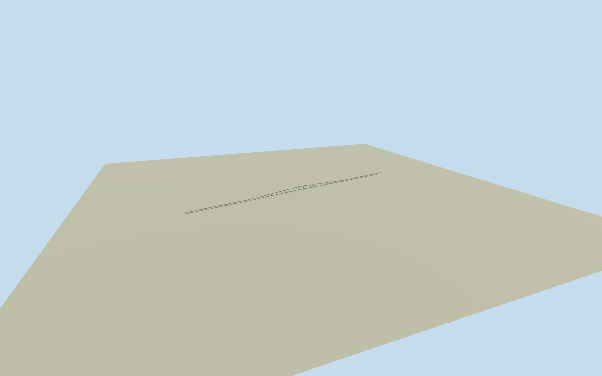

# Governor Nobre de Carvalho Bridge (2009)

Complete Governor Nobre de Carvalho Bridge crossing in the2009 creator-video phase after the2005 north-approach alteration: full mapped main bridge,9.2m deck/two traffic lanes/two narrow raised sidewalks, ogival raised deck profile, central70m navigation opening, all prestressed concrete T-beam/box-girder understructure/piers/abutments/footings, white open picket railings and curved white lamps. Whole hidden sections/census/profile registration/grade are explicit estimates. Exclude removed1974 north viaduct, city junction roads beyond abutments, otherMacau bridges, casinos/cityscape/vehicles/people/signlettering/audio. Owner original2569.8m and engineer approximately3km group are historical/different scopes, not a mandate to stretch the current native post2005 mainbridge.

Authoring state: **review-in-qa.json**. Current completion evidence is in [qa.json](qa.json) and the [completion ledger](../../../../qualla-structures/batches/qualla-002.PROGRESS.md).

- [Governor Nobre de Carvalho Bridge](https://qualla.com/governor-nobre-de-carvalho-bridge/)

NativeQ977841 whole main crossing:5-control roadway22988070/10-control closed physical outline1054315892/two intrinsic sidewalk ways1184621065 and1184621066. All1077 reservations and these mappedIDs/aliases clear. Post2005 mainbridge alignment registered to2009 creatorPDvideo phase approximately; original1974 owner2569.8m and engineer approximately3km inclviaducts are different scopes, not stretched onto current mainbridge. Native footprint is not an exact metric survey.

Complete Governor Nobre de Carvalho Bridge crossing in the2009 creator-video phase after the2005 north-approach alteration: full mapped main bridge,9.2m deck/two traffic lanes/two narrow raised sidewalks, ogival raised deck profile, central70m navigation opening, all prestressed concrete T-beam/box-girder understructure/piers/abutments/footings, white open picket railings and curved white lamps. Whole hidden sections/census/profile registration/grade are explicit estimates. Exclude removed1974 north viaduct, city junction roads beyond abutments, otherMacau bridges, casinos/cityscape/vehicles/people/signlettering/audio. Owner original2569.8m and engineer approximately3km group are historical/different scopes, not a mandate to stretch the current native post2005 mainbridge.

Original independent3072m field/frame before ALL floors/mainsections/geometry, then preserve without flattening/refitting/reacquiring/reframing.

Owner35m maximumdeckabove sea/9.2m overall/two-way lanes/edgewalkways/continuousprestressedconcrete; engineer centralnavigation70m/T-beam andbox-girdertypes. Full hidden sections/other span census/haunches/footings/grade are boundedestimated, no fabricatedexact asbuilt claim.

Video shows roadphase/profile/railings/curvedlamps, not whole underside or all piers. No protectedimages/people/vehicles/signlettering/neighborbuilding/audio adopted.

All2448.157m native bounded mainbridge represented,5centerline/10outline controls. Native modern main crossing used as approximate2009 registration; historicremoved northviaduct/original2569.8m ownertotal and engineer approximately3km group not conflated with mainbridge.

35m peakdeckabove sea/9.2m width/70m navigation andT-beam-plus-box types primarytext facts. Raisedprofile1213m extent, exactT/box boundaries,1.8–3.1m boxdepth/1.35m Tgirders/piersections/census/footingdepth/grade explicitly estimated. No giant structuralarch invented under ogival deck.

Full ordinarypier census estimated as80equal29.739m spans plus one70m central navigation opening, all82supportgroups retained. Two intrinsic endabutments, allnearfootings/bearings/crossheads/Tbeamfourgirders/closedboxwithrealinnercell.

White densepicket count reduced for medium-fi: near1.05m/street6m/district supportbayposts; reference has denserpickets. FourLODs retain wholecrossing/ogivaldeck/70mopening/allpiers/railing andcurvedlamp sequences.72lampcensus andsmallsections estimated.

Originalfieldrange−13.2339..79.842mabsolute includesbay/coast/compositewater/shorebuilding artifacts, not bathymetry or historicgrade certification. No cutout/mask/flattening/reacquisition/reframing/deckorfootingrefit after renders.

Build: `node content/worldgen/source/places/we/web/governor_nobre_de_carvalho_bridge/models/generate-house.mjs`. Add `--check` to verify exact regeneration. 63800 triangles; 5 materials; no embedded photographs.
