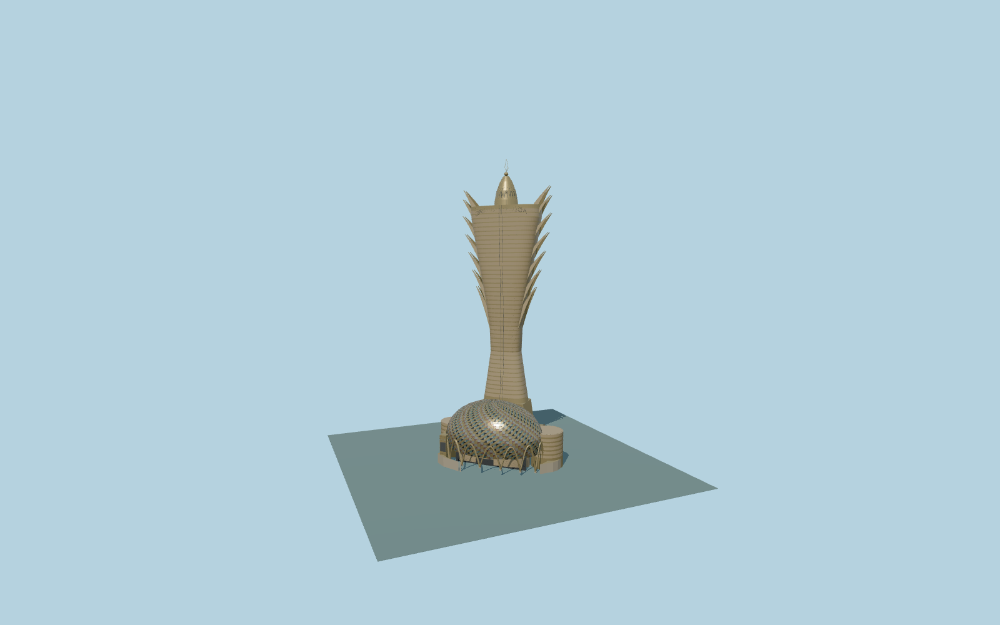

# Grand Lisboa

Complete261m Grand Lisboa:gold/slate narrow-waisted lotus/feather hotel tower with stepped curling leaf edges,ogive/globe/open crown,front triangular mirrored ovoid casino,pointed entry arches,blank sign pylon and paired side annex terraces.

Original source:models/grand-lisboa-model.mjs,layout.json and attributed map/global-terrain controls. Rebuild with `node packages/worldgen/scripts/generate-grand-lisboa.mjs`;append `--check` for exact bytes. Import/LOD commands select `--ids=grand_lisboa`. GLBs are ignored outputs.

Five existing shared256px graphs plus palette blank sign;no private or embedded images. Detailed master and four browser tiers are separate. The55m parent is the lower casino,not the full landmark;the separate210m generalized tower footprint anchors the rear shaft. Retained261m total includes crown/finial. Internal+U points approximately east,+V south toward the ovoid/entry. Individual curling leaf solids,waist,triangular mirrored shell,pointed arches and paired annexes establish the unique exterior. Curved/ornamental sections,facade inventories and native site grades remain reconstructed approximations. See model-brief.json and qa.json for scope/current acceptance.

Original geometry uses the repository license. Maps:© OpenStreetMap contributors,ODbL-1.0;Protomaps. Raw global terrain hashes/attribution:terrain-grid.json. Linked ordinary pictures are not redistributed or used as textures.
