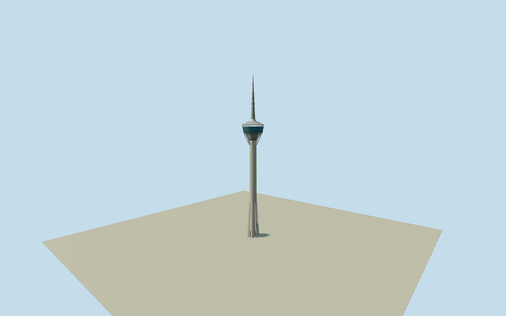

# Macau Tower

338mMacau Tower exterior: tapered16→14mconcrete shaft, eight native-positioned raking base legs and service strip, stepped silver underside/radial pod braces, blue observation/restaurant glazing with160representative panes, open SkyWalk/rim and native projecting bungy platform, conical silver crown and stepped90mcommunication mast. Native overhead pod polygons are preserved as overhead shapes; no whole plaza or related convention buildings.

Authoring state: **review-in-qa.json**. Current completion evidence is in [qa.json](qa.json) and the [completion ledger](../../../../qualla-structures/batches/qualla-002.PROGRESS.md).

- [Macau Tower](https://qualla.com/macau-tower/)

Original named/wikidataQ1568304OSMrelation21176879and three native outer members establish axis, projected pod/SkyWalk shape and bungy projection; these are overhead architectural perimeters, not a ground parcel. Original coordinates retained. Protomaps tower/base-part footprints supply quantized eight-raking-leg positions. Native74mlegheight retained; mapped223mLevel61height conflicts with published233moutdoor deck, so measured-looking native height is not adopted for that level. Public tower federation values338mtip,223mobservation,228mrestaurant,233moutdoor deck,90mmast,16/14mshaft diameters bound the section; exact connections/hidden details remain photographic estimates.

Published Qualla edited2003pod photograph is bound to original photographer and editor native firstPD-selfreleases; exact supplemental2007PD-selfand2026CC0originals establish full shaft/pod/mast silhouette. No other-licensed images, photo textures, visitor likenesses, logos, signs, artworks or underlying unrelated hotel/pool construction reproduced.

Primary public operator/federation levels control height:338mtip,223mobservation,228mrestaurant,233moutdoor,90mmast and16/14mshaft diameters. Pod profiles/crown transitions, eight upper braces, shaft strip phase, window/panel repeat, raking-leg sections and tiny antenna attachments are medium-fi estimates. Near160representative panes simplify at distance; nativeoverhead pod/SkyWalk and bungy outlines are not extruded as ground parcels.

Native relation21176879fixes identity/axis and original projected pod rings. Eight base-leg placements use quantized native basemap part outlines with74mheight; actual footing/steel sections/connection details approximate. Related Convention and Entertainment Centre, whole plaza/roads/water/landscaping, temporary attractions and interior room/exhibition geometry are outside this tower-only scope.

Fixed dry southern approach[0,26]/Y0 precedes terrain acquisition. Raw source terrain retained without flattening/fitting; isolated review groundY-.22does not certify exact host contact, threshold levels or foundation depth. No full-site slab, artificial reclamation terrain or foundation lifted to match vegetation/building returns.

Build: `node packages/worldgen/scripts/generate-authored-places.mjs --ids=macau_tower`. Add `--check` to verify exact regeneration. 26160 triangles; 5 materials; no embedded photographs.
