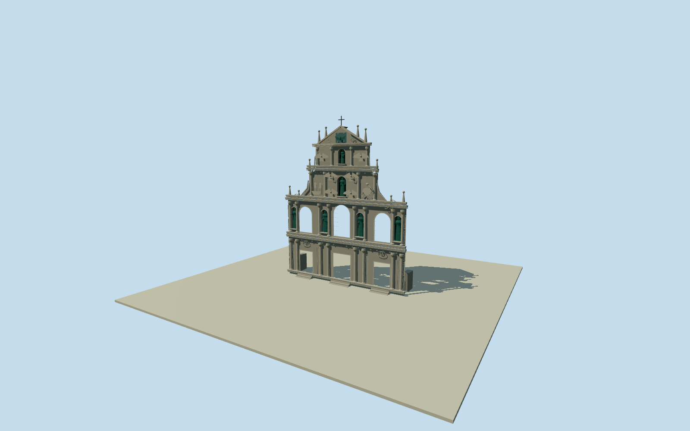

# Ruins of Saint Paul's

Complete surviving five-tier granite facade with3real open portals/upper lights, bronze saints in deep shell niches, layered paired columns/capitals/entablatures, carved ship/dragon/skeleton/hourglass/angel/scroll relief, triangular dove/sun/star pediment, pin finials/cross and bounded threshold stairs/low rear remnants. No burned church or long public stairway reconstruction. Complete compiled-native thin facade extent; elevation detail and concealed rear supports are photographic estimates.

Authoring state: **review-in-qa.json**. Current completion evidence is in [qa.json](qa.json) and the [completion ledger](../../../../qualla-structures/batches/qualla-002.PROGRESS.md).

- [Ruins of Saint Paul's](https://qualla.com/ruins-of-saint-paul-s/)

Exact named facade building/POIidentity35184564272017 compiled from OSMway192183185 in Protomaps20261019archive. Complete thin four-corner polygon retained in its native signed frame. Compiled tile coordinates are quantized at maxzoom15and are not survey/original-node precision. Height26.2m is the compiled native height attribute; facade sections/detail and rear thickness/supports remain photographic estimates. Nearby college-ruins POI35185373884295 is a separate site identity and must not become an invented standing church. Original OSMAPI/Overpassretrieval was rate-limited/unavailable; no unverified original payload is claimed.

The surviving church facade is the structure in scope: complete five-tier front/back and three portal/upper-light openings. Burned1835church/roof, separate college/museum/crypt/temple/city wall and public plaza are excluded. The68-step public approach lacks a complete accepted image/native footprint here and is not invented; only short intrinsic threshold stairs are modeled.

One exact published QuallaGG001213CC0front original2017and one explicitly self-dedicatedMx.GrangerCC0column/joint/detail original2018were inspected. The Colegiofile is a crop of the same Qualla photo and not an independent reference. No attribution/share-alike/unknown-author image or photographic texture used.

Compiled native facade width21.29m/thickness1.93m/height26.2m controls scale. Exact elevation tier heights, sculptural projections, repair plaster, small thresholds and rear support/remnant sections are medium-fi photographic estimates, not a survey. Signed native outline faces south/slightly east; contradictory east-facing story prose is not used as a bearing control.

Six patinated saints use statically baked public Molen figure anatomy under original long robes/attributes. Carved ship/dragon/skeleton/hourglass, angel figures, sun/star/dove, scrolls and capitals are bounded original relief; fine faces, exact iconographic identities, inscription fonts, Chinese characters and erosion are approximated or omitted. MATERDEIis the visible bounded Latin entrance inscription; other detailed writing is not invented.

Fixed front point[0,4.5]is defined before terrain acquisition. Intrinsic footings extend.25m below datum; model/host-terrain contact and precise thresholds remain unverified. No whole-site slab or ground flattening.

Build: `node packages/worldgen/scripts/generate-authored-places.mjs --ids=ruins_of_saint_paul_s`. Add `--check` to verify exact regeneration. 58227 triangles; 4 materials; no embedded photographs.
