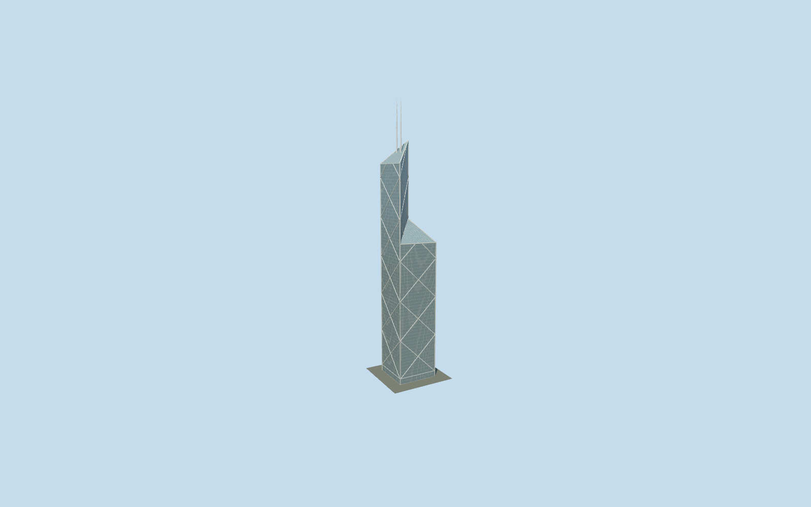

# Bank of China Tower

I.M.Pei’s four triangular glass shafts cut down successively into diagonal roof planes, a bold silver triangular mega-frame and paired slender masts at the precisely mapped highest quadrant.

## Evidence and reconstruction

Published dimensions and reconstructed details are separated in spec.json. Primary references:

- [Reference](https://www.pcf-p.com/projects/bank-of-china-tower/)
- [Reference](https://bocgroup.com/en/aboutus/corpprofile/boctower.html)
- [Reference](https://www.openstreetmap.org/way/25604760)

No third-party geometry, photograph or bitmap texture is embedded. Shared surface graphs come from the central library; vertex tints carry model colors. Glazing uses PBR materials; transparent surfaces are declared per model.

## Model and axes

156,097 triangles; 462,531 vertices; 3 material groups; 18,526,660 bytes. Native bounds: -27.349, 0.000, -27.267 to 27.349, 367.400, 27.267. Source hash: `sha256:7193bb67a6a8939d205e5274f0992b55fc8a48bf7df2d2cc7e2d8150704a7cad`.

{"up":"+Y","longitudinal":"+X along the mapped building long axis","front":"+Z","origin":"Ground-level center of exact-QID mapped footprint frame"}

Retained exact-QID way25604760 fixes anchor and metric envelope. Four attributed triangular building parts279949066–069 preserve their separately mapped roof compass bearings. Independent mast centers279949064/065 resolve the square frame rotation and occupy the highest quadrant. Directed heading1.293228519094 and anchor[114.16156875,22.2792677] are unchanged. Published315m roof and367.4m mast datums are retained; mapped roof heights use the existing+5m adjustment. GroundY0 and sloped street/curb contact are unsurveyed. Surrounding water gardens and interiors are excluded. This is retained map/picture registration, not a new terrain survey.

## Reproduce

Run `node packages/worldgen/scripts/generate-signature-towers.mjs --ids=bank_of_china_tower` (or add `--check`). The generator preserves manually edited masters by checking their baseline hashes. Import through the standard authored-model workflow with optimization disabled; then capture all QA cameras, including shared-surface views.

## Pending work

- Exterior geometry uses published overall dimensions and map evidence; panel subdivision, connection dimensions and local entrance details are reconstructed. Glazing uses opaque PBR with explicit geometry; no copied facade photograph is embedded.
- Diagonal mega-frame geometry is explicit; exact connection plates and individual spandrel junctions are reconstructed. Mapped53 m envelope includes the facade around the architect52 m structural square. Surrounding sloped water gardens are outside the asset.
- Original156097-triangle source master is preserved byte-for-byte. Browser levels preserve all four independently mapped triangular shafts, roof slopes, primary diagonal mega-frame, lifted banking-hall belt, corner columns and paired masts. Skyline uses planar structural bands and six-sided masts; district restores solid structural members and sparse glazing divisions. Street restores intermediate mullions and roof grid; close-up restores1.55m by4.15m glazing divisions, dense roof framing and mast collars. Shared stainless approximates silver facade cladding; granite is a shared foundation surface; vision glass is opaque PBR. Pane joint recesses and engineered connection plates remain in the source approximation rather than browser microgeometry. Frame widths and floor pitches are reconstructions. No new survey, exact curb/terrain contact or physical-device timing is claimed.
- LOD error values0.8/0.5/0.2/0.1m are authoring estimates, not certified whole-mesh Hausdorff distances. Forced close distant tiers deliberately expose broader frames and coarse masts.

This bundle follows the medium-fi standard. Medium-fi appearance and geographic fit are reviewed separately. Hash-bound visual acceptance is recorded separately after capture inspection.
