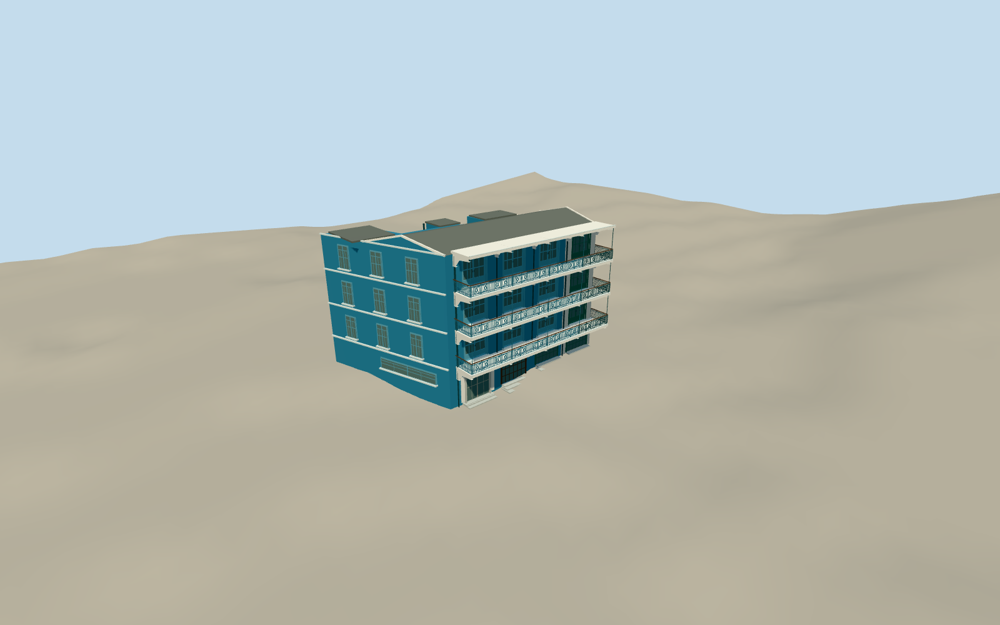

# Blue House (Hong Kong)

Four connected Hong Kong shophouse units: three blue and one white end unit, three tiers of cantilevered balconies with concrete corbels and ornamental ironwork, paired glazed doors, shopfronts and clinic canopy; shallow gable roof and modern rear access stairs.

Authoring state: **review-in-qa.json**. Current completion evidence is in [qa.json](qa.json) and the [local 100 ledger](../../../../qualla-structures/batches/PROGRESS.md).

- [Blue House (Hong Kong)](https://qualla.com/blue-house-hong-kong/)

Current construction uses exact native named-photographer CC0 2020 front/corner after Qualla-first111records. Twelve front paired-door pockets and closed ornamental railings built from inspected native detail. Earlier attribution/private/aerial controls are historical and excluded; full original four-unit house/white74A/roof/rear access/shopfront scope retained, broader rear/hidden roof fidelity pending. Dimensions, recesses, iron profiles and current condition remain estimates.

Four contiguous72–74A Stone Nullah Lane units only, including white-painted74A. Separate Yellow/Orange Houses, courtyard landscaping, neighboring bridges, interiors, signs lettering and street furniture excluded.

Close front ironwork uses physical elliptical/circular/side-loop stocks and twelve paired-door recesses; all three original lower levels remain exact. LODerror estimates increased conservatively for new recess depth, not measured geometric-error certification. Rear stair positioning/hidden details retained as estimates pending wider cleared evidence.

Independent terrain compatibility is recorded in qa.json. Footprint replacement disabled; no photographic pixels redistributed and no physical-device performance measurement claimed.

Build: `node packages/worldgen/scripts/generate-authored-places.mjs --ids=blue_house_hong_kong`. Add `--check` to verify exact regeneration. 34050 triangles; 6 materials; no embedded photographs.
