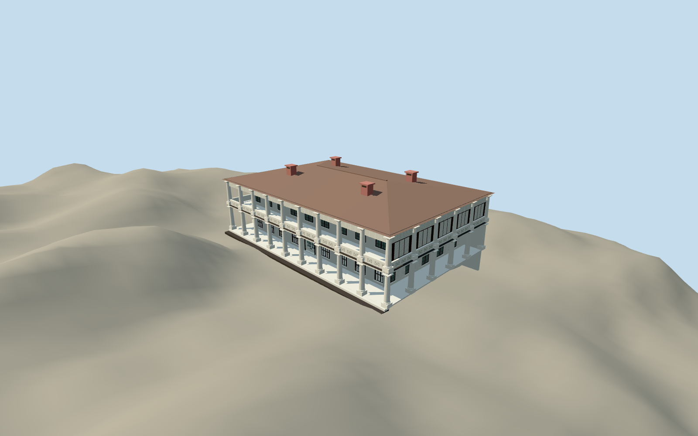

# Flagstaff House (Hong Kong)

Original two-storey Greek Revival house with deep white colonnaded verandahs, dark framed sash windows, closed internal lower-front louvers behind recessed lattice and white paired paneled entrance doors with physical fanlight, panelled upper balustrade, white louvred side galleries, shallow hipped tiled roof and four pink chimneys. Later gallery and connecting passage excluded.

Authoring state: **review-in-qa.json**. Current completion evidence is in [qa.json](qa.json) and the [local 100 ledger](../../../../qualla-structures/batches/PROGRESS.md).

- [Flagstaff House, Hong Kong](https://qualla.com/flagstaff-house-hong-kong/)

Current construction uses exact native same-photographer public-domain2007front after Qualla-first93records; first own-photo grant/native upload identity bound. True arched entrance/white paired paneled doors/closed fanlight stocks/eight lower-front recessed internal louvers built. Earlier attribution/private/aerial controls excluded; full main-house/verandas/columns/hipped roof retained pending broader exterior/roof review. Dimensions, bay counts, columns/upper rail/rear details and present condition remain estimates, not measured elevations.

Original house only. The later K.S.Lo Gallery and narrow connecting passage, temporary exhibition banners, interiors, garden objects, trees and fine signage are excluded.

The official5m DTM has published±5m accuracy at90% confidence; rear ground and foundation cannot be certified from the front photograph. Source terrain remains unmodified. Close new joinery has real recess/closed stocks/metric UVs. Three original lower geometry streams remain exact; conservative LODerror estimates.55/.4/.32m account for recess depth without claiming measured geometric-error certification. Fine columns/upper rail/side galleries/roof profiles remain original estimates pending wider cleared evidence.

Placement preview only; generic-footprint replacement disabled. Photographic pixels are not redistributed and no physical-device performance or survey accuracy is claimed.

Build: `node packages/worldgen/scripts/generate-authored-places.mjs --ids=flagstaff_house_hong_kong`. Add `--check` to verify exact regeneration. 22783 triangles; 5 materials; no embedded photographs.
