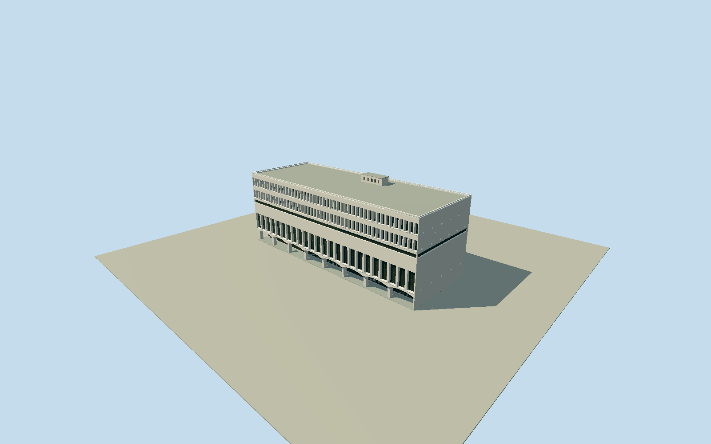

# General Post Office, Hong Kong

Whole named1976 Hong Kong General Post Office: original13-vertex building envelope and9-vertex five-storey/6-vertex three-storey office components. Broad low white limestone-faced modernist block, flat roof/parapets, two upper office window rows with actual deep splayed white reveals, dark intermediate ribbon, tall public-hall window bays, projecting scalloped concrete canopy and open ground piloti, relatively solid east side/fins, lower rear wing and bounded small roof plant. POI polygon identifies office only. Exclude separate IFC/Jardine House, exterior banners/sign lettering/flags, connecting public walkways, street, construction site, people, vehicles, gardens and interiors. Preserve all13whole/9main/6low original vertices/entrance notches; main/low union is whole building, no stretched parcel. Main parapet30.1m map height unsurveyed; upper office rows have real deeply recessed glazing and splayed white reveals/fins, not decals. Tall hall windows recessed between white piers; public ground piloti physically open behind repeated shallow segmental scalloped canopy. Central hall side and concealed north/rear profile bounded, roof plant minimal. Avoid canopy slot/roof coverage over unrelated site. Coarsen facade count for far LODs, preserve whole5/3-storey mass and open lower front. Freeze independent400m129x129 field before geometry; raw values unchanged/no fit/flatten/reacquire.

Authoring state: **review-in-qa.json**. Current completion evidence is in [qa.json](qa.json) and the [completion ledger](../../../../qualla-structures/batches/qualla-002.PROGRESS.md).

- [General Post Office, Hong Kong](https://qualla.com/general-post-office-hong-kong/)

Original whole named buildingway1047782723/all13vertices and original officeparts16281866/all9vertices/five levels/nativeheight30.1m,184767036/all6vertices/threelevels. Original15-vertex amenity polygon184705579/Q840868 confirms identity only, not physical building boundary. Mean whole-building vertex anchor; +X along original long southwest front from166091181 toward166091396, +Z southwest outward. Part rings/entrance notches retained without rectangle fitting. Native30.1m height is an unsurveyed map attribute adopted as overall principal parapet; facade floor levels, canopy/roof-part heights and hidden rear are original bounded photo interpretations.

Qualla-first95 families/zero conflicts. Two published creatorCC0 originals show only interior counter/sign and are not used for exterior. Two exact supplemental own-work/self-cc-zero exterior originals by Poonumia Liurellb2024 and Luksongm MWLLOPPEE2026 individually inspected/nativeSHA1 matched/grants bound; existing supplemental policy passes unchanged. No official-source imagery, source photo textures/generated bitmap/downloaded mesh or copied banners/lettering.

Whole native13-vertex building and9/6-vertex office parts retained. Principal30.1m parapet follows unsurveyed map height; low roof17.5m/parapet18.1m, canopy5.4m, tall hall5.7–12.6m, ribbon17.2–18.5m/two office rows19.4–22.8m and24.5–27.9m and rooftop plant32.12m are original estimates. Eight scalloped canopy bays/24 tall hall bays/48 splayed office bays represent photographic rhythm; exact census/depth/rear/roof plant and present cosmetics bounded. Three-storey rear fenestration is approximate; not an interior reconstruction.

Government text identifies1976 building and planned redevelopment demolition; no verified completed demolition is asserted. Represents photographed2024/2026 form. Separate IFC/Jardine House, old1911 predecessor, connecting public walkways, flags/sign letters/banners, urban street/site floor/gardens/construction/people/vehicles excluded. Ground piloti/curved underside physically open; own building floor only.

Independent400m129x129/16641 samples/two original Terrarium tiles frozen before geometry. Provider datum14.3467m and whole absolute[-679.8011,66.6877]m retained unchanged/no fit/flatten/reacquire. Implausible deep negative coastal composite values are not harbor bathymetry or foundation controls; review PNG quantization max0.00573m is encoding precision only. Flat portable/shared/context fixtures separate. Native preview/replaceFootprint=false, actual host urban grade/threshold contact unverified.

Build: `node packages/worldgen/scripts/generate-authored-places.mjs --ids=general_post_office_hong_kong`. Add `--check` to verify exact regeneration. 20772 triangles; 5 materials; no embedded photographs.
