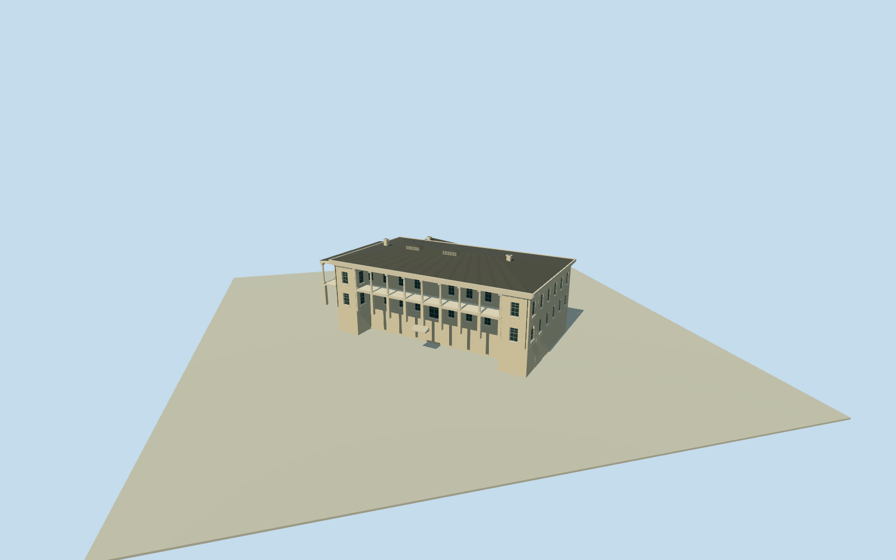

# Government House, Hong Kong (original house,1870s)

Complete original1855GovernmentHouse as photographed in1870s: whole two-storey colonial residence/upper opencolonnaded veranda/solidendwindowpavilions/projectedcornices/sideveranda/full hiddenlowerfloor/rear/servicebody/closedlowhippedroofs/roofvents/chimneys. Exact clearedpublishedLaiAfongoriginal only. Current27controlphysicalhouse42258038 and23controlopenestate392192459/Q838415 establish approximate originalsite context, not measured1870sfootprint; whole oldhiddenplan/roof/sections/registration bounded estimates. Exclude later1889easternannex and1941–45central tower/Japanese roof remodel/currentArtDecofinish, separateestate/gardenfountain/statue/palms/ships/neighborhood/copiedfigurativeart/interiors.

Authoring state: **review-in-qa.json**. Current completion evidence is in [qa.json](qa.json) and the [completion ledger](../../../../qualla-structures/batches/qualla-002.PROGRESS.md).

- [Government House, Hong Kong](https://qualla.com/government-house-hong-kong/)

ExactQ838415 nativeWikipedia/current27controlnamedbuilding42258038 distinct23controlresidentialestate392192459. Original1870sMainHouse pre1889eastannex and preJapanese central tower is the represented whole physical building. Currentbuildingoutline is approximate originalsite context only, not historicplan to extrude unchanged; whole oldbody/hiddenrear/service roofs estimated. Openestate never solid building. Original registration±12m/bearing±12degrees, sourceheading0/+Xeast/+Zsouth fixed beforefield/mainparameters. All1077every-statusreservations clear.

Whole original1855house as photographed1870s required, including hiddenlower/rear/servicebody/closedroofs. Do not narrow to a frontage or extrude later1889easternannex/1940scentral tower from currentoutline.

PrimaryAMO identifies1855completion/1889easternannex/JapaneseOccupationcentral tower. Laterfinish/tower/roof are not1870sfacts. Gardenfountains/statue/palms/boats/neighboringstructures excluded.

ActualLaiAfong1839–1890/nativeexplicitPD-old-70/2081x1483original/primaryGettyalbumleaf1870s bound, ordinarypublishedpolicy unchanged. Quallamedia/rights/artist andarticlebody untouched.

Original independent256mfield/frame before all floors/mainsections/geometry; neverflatten/reacquire/reframe orfitmainsections afterrenders.

Hidden1870swholeplan/roof/rear/sections/window-and-columncensus/registration andgrade bounded estimates, exactmetric survey not required.

Exact front44m/depth25m,9uppercolumns/8bays/6sidecolumns, floor and eave heights, windows/rooflights/chimney census, whole hidden lower/rear-service plan/roof are photographic bounded estimates. Rearreturn/connector close the residence; no façade-only stand-in. Low hippedroof, square cornice and plain cylindrical-column/base/simple capital character follow exact LaiAfong plate. No laterannex/tower/Japanese roofwork, copied gardenstatue/fountain/people/plants/ships/interiorart.

Historic house orientation follows current westhouse6→7 only as approximate context, reconstructed old footprint is independent of27moderncontrols and open23controlestate. Mainregistration±12m/bearing±12degrees. Sourceframe/field unchanged; no groundcutout or broadsitepad.

Uniform pale lime finish/gray roof are restrained medium-fi interpretations of monochrome1870s photograph, not measured paint colors. Hidden window/door arrangement, simple classical capitals and rooflight slats estimated.

Build: `node content/worldgen/source/places/we/wec/government_house_hong_kong/models/generate-house.mjs`. Add `--check` to verify exact regeneration. 17266 triangles; 6 materials; no embedded photographs.
