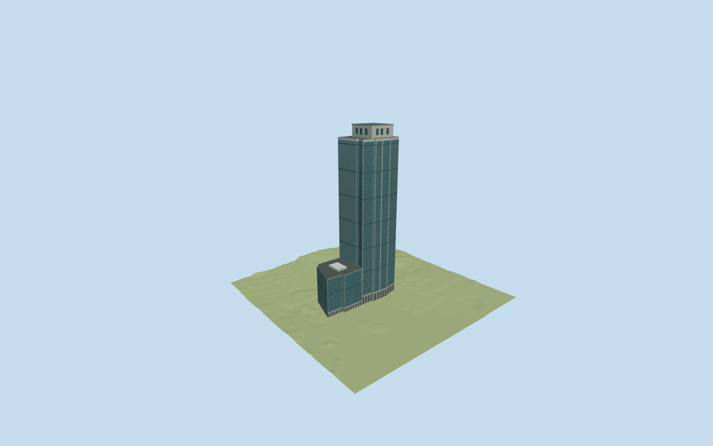

# Hong Kong Police Headquarters

Arsenal House in Wan Chai with its 206-metre High Block, stone base, alternating metal and glass elevations and attached Low Block.

Authoring state: **review-in-qa.json**. Current completion evidence is in [qa.json](qa.json) and the [completion ledger](../../../../qualla-structures/batches/qualla-003.PROGRESS.md).

- [Hong Kong Police Headquarters](https://qualla.com/hong-kong-police-headquarters/)

Exteriors of the 2004 High and Low Blocks only. Earlier East and West Wings, Caine House and neighboring structures are outside this scope.

The tower height and building outlines are evidence-based. The parapet heights, trim, glass module and sheen, low-block roof height, and street-level bay proportions are estimates.

All geometry depicts the public skyline and visible cladding only. The low block is an approximate simple stepped mass.

Build: `node content/worldgen/source/places/we/wec/hong_kong_police_headquarters/models/generate-hong-kong-police-headquarters.mjs`. Add `--check` to verify exact regeneration. 3542 triangles; 4 materials; no embedded photographs.
