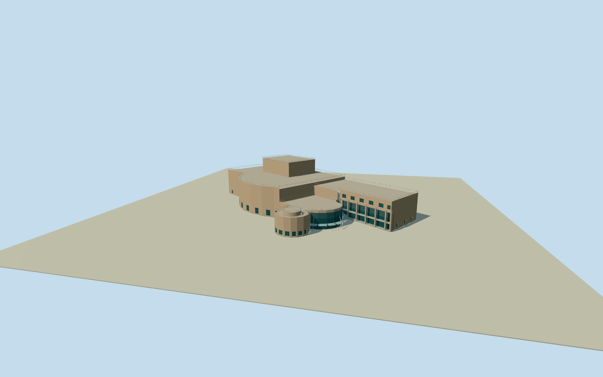

# Kwai Tsing Theatre

Whole native48control theatre exterior: buff tiled auditorium/service blocks and taller rectilinear flytower, curved glazed entrance foyer/closed doors/whitefascia/parapet, real suspended curved canopy/splayed masts/tension rods, adjoining curved restaurant/roofdrum and columned deeply recessed sidewing. Whole mapped outline and native bearing retained; heights/internal part boundaries/hidden faces original bounded reconstruction. No plaza/roads/neighbors/sculpture/ads/interiors.

Authoring state: **review-in-qa.json**. Current completion evidence is in [qa.json](qa.json) and the [completion ledger](../../../../qualla-structures/batches/qualla-002.PROGRESS.md).

- [Kwai Tsing Theatre](https://qualla.com/kwai-tsing-theatre/)

Exact whole native theatre way142662156/Q606350 with all48 unique exterior controls retained, including curved foyer and attached wing. Fixed native bbox midpoint/+Xeast/+Zsouth/heading0. Nearby similarly named bus stop nodes/transport relations are not the structure and not used. Architectural sections/components must be reconciled to the complete native outline after independent field freeze, never rectangular whole-property extrusion.

All floor/section/geometry choices follow immutable400m129x129 field freeze. Floor0 at fixed-.6065m provider-relative SW datum, nofit/flatten/reacquire. Whole48nativecontrols remain exact in +Xeast/+Zsouth frame; internalconstructionaxis derives native long back wall45-to44, not a remapped perimeter. Native building plan has no surveyed heights/part outlines. Bounded photo-based18m auditorium/16m sidebar/9.8m curved foyer/1.1m parapets/28m eight-level flytower interpretation, curved restaurant/roofdrum/canopy/columns and hidden openings are explicit original estimates. Physical.28m window/.42m closeddoor recesses and2.5m open colonnade. No interior/seating/undercroft/spring system/plaza model. Grade/threshold/currentfinish/hiddenfaces unresolved.

Five exact already-published2006/2007 Chong Fat creatorPD exteriors only; protected hero/nightphotos, interiors, ads/sculptures and unrelated imagery unselected. No supplemental imagery/copied texture pixels/generated bitmap or article/media/rightsmetadata repair. Native48control whole outline retained; internal boundaries/heights/hidden elevations/opening census/finish and canopy support arrangement original bounded estimates. Glass/canopy use opaque medium-fi surfaces without an interior/sorting claim.

Independent400m129x129field16641values/two raw tiles frozen before all floors/sections/geometry. Fixed-.6065m provider-relative SW datum unchanged; urban source includes tall building artifacts and source ground/thresholds are unsurveyed. Geographic preview/replaceFootprint=false, no fit/flatten/reacquire or plaza plate.

The final source-field view obscures most of the theatre beneath broad urban elevation artifacts. Geographic ground contact fails and remains unresolved; the isolated and shared-material views verify the building model, and this placement is not ready for site activation.

Build: `node content/worldgen/source/places/we/wec/kwai_tsing_theatre/models/generate-kwai-tsing-theatre.mjs`. Add `--check` to verify exact regeneration. 13816 triangles; 5 materials; no embedded photographs.
