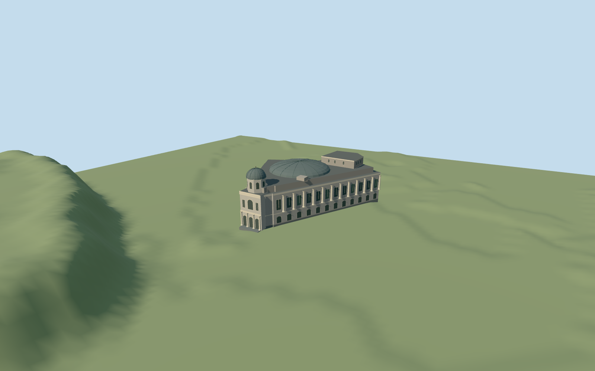

# Lee Theatre

Hong Kong’s former Lee Theatre with a domed corner tower, marble-clad street elevations and a broad auditorium roof, on its original 1975 surveyed footprint.

Authoring state: **review-in-qa.json**. Current completion evidence is in [qa.json](qa.json) and the [completion ledger](../../../../qualla-structures/batches/qualla-003.PROGRESS.md).

- [Lee Theatre](https://qualla.com/lee-theatre/)

This dated exterior uses the 1975 historical wall outlines and a second survey from 1989. The modern Lee Theatre Plaza is outside scope. The placement interval covers the surveyed theatre and ends after the last August 1991 performance.

Wall heights, roof profile, number of columns, window shapes, lettering, ornament and exact facade tones are interpretive. The documented domed auditorium informs one low domed roof, and the entry tower is a distinct smaller feature.

Original Hong Kong Lands Department terrain provides modern bare-earth geometry and a street-level datum. Historic paving, landscaping, steps and adjacent buildings are approximated or outside scope.

Build: `node content/worldgen/source/places/we/wec/lee_theatre/models/generate-lee-theatre.mjs`. Add `--check` to verify exact regeneration. 10914 triangles; 6 materials; no embedded photographs.
