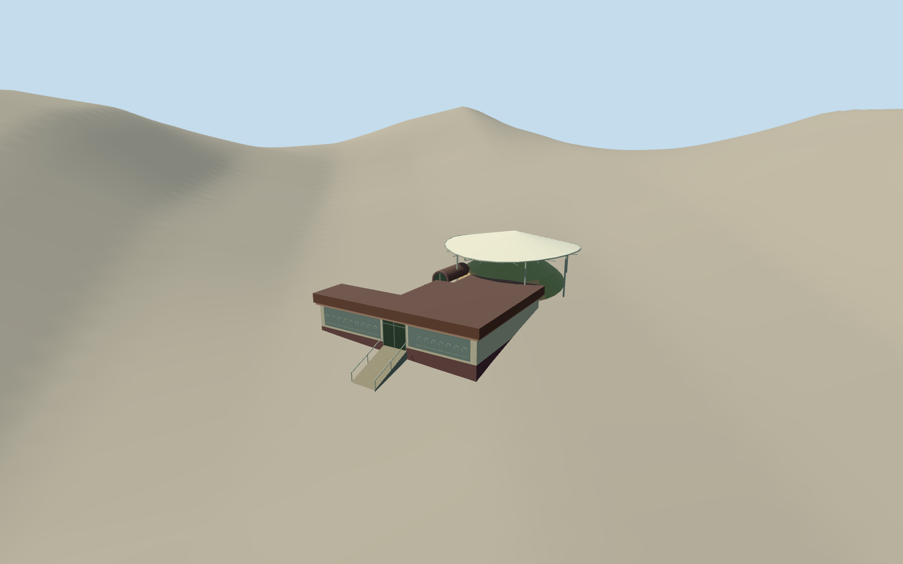

# Lei Cheng Uk Han Tomb Museum

The low relief-fronted gallery at Tonkin Street and the white protective canopy above the grass-covered Han burial mound and glass viewing passage.

Authoring state: **review-in-qa.json**. Current completion evidence is in [qa.json](qa.json) and the [completion ledger](../../../../qualla-structures/batches/qualla-003.PROGRESS.md).

- [Lei Cheng Uk Han Tomb Museum](https://qualla.com/lei-cheng-uk-han-tomb-museum/)

The museum is represented in January 2008. The gallery follows its mapped footprint. The mound, protective canopy, glazing, entrance ramp and rear levels use photo-based dimensions.

The original source field is preserved. The turf and exposed soil depict the protective exterior treatment. The historic tomb interior and inscriptions are outside the modeled exterior.

The architectural relief panels use simplified original geometry. Photograph captions and EXIF place the visit on adjacent days in January 2008.

Build: `node content/worldgen/source/places/we/wec/lei_cheng_uk_han_tomb_museum/models/generate-lei-cheng-uk-han-tomb-museum.mjs`. Add `--check` to verify exact regeneration. 1921 triangles; 5 materials; no embedded photographs.
