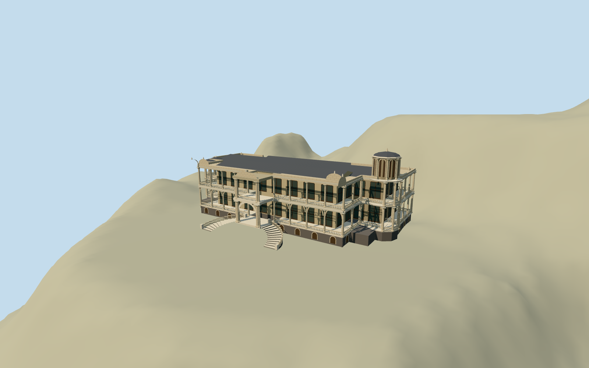

# Marble Hall (Hong Kong)

Sir Paul Chater’s hilltop Marble Hall at 1 Conduit Road, with two levels of verandahs, the split curved entrance stair, stone basement, and the western cupola.

Authoring state: **review-in-qa.json**. Current completion evidence is in [qa.json](qa.json) and the [completion ledger](../../../../qualla-structures/batches/qualla-004.PROGRESS.md).

- [Marble Hall (Hong Kong)](https://qualla.com/marble-hall-hong-kong/)

Models the mansion exterior with the immediate stair and verandah. The larger grounds, distant servant outbuildings, collection and surviving gatekeeper’s lodge are outside the asset.

Geographic registration and rotation are approximate within the documented lot. Historical terrace heights, colors, rear elevation openings and hidden roof slopes are estimated.

The separate 1906 residence uses modern bare-earth heights as a geographic reference.

Build: `node content/worldgen/source/places/we/wec/marble_hall_hong_kong/models/generate-marble-hall-hong-kong.mjs`. Add `--check` to verify exact regeneration. 41444 triangles; 7 materials; no embedded photographs.
