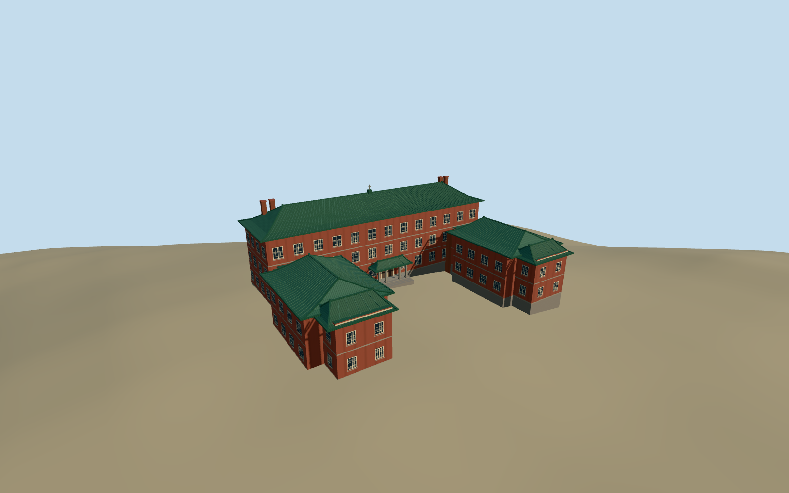

# Maryknoll House, Stanley

Maryknoll House’s historic brick main block and lower courtyard wings, fitted to the Stanley hillside, with green glazed Chinese tiled roofs, north entrance and stepped seaward verandah.

Authoring state: **review-in-qa.json**. Current completion evidence is in [qa.json](qa.json) and the [completion ledger](../../../../qualla-structures/batches/qualla-003.PROGRESS.md).

- [Maryknoll House (Stanley)](https://qualla.com/maryknoll-house-stanley/)

This is the historic main block and two wings in the standing form documented before the recent adaptive-reuse works. Approved modern extensions and adjacent residential blocks are separate.

Stories and structural footprints are mapped. Exact roof rise, section heights, masonry joints and some window divisions and connections are estimated from the photo and descriptive records.

Build: `node content/worldgen/source/places/we/wec/maryknoll_house_stanley/models/generate-maryknoll-house-stanley.mjs`. Add `--check` to verify exact regeneration. 21284 triangles; 7 materials; no embedded photographs.
