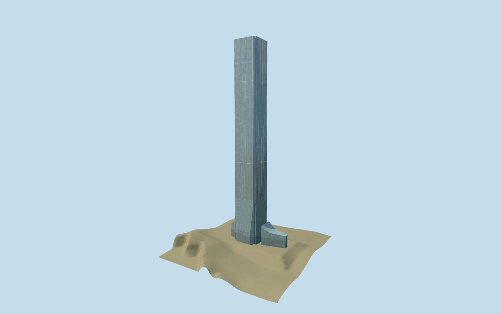

# International Commerce Centre

Budgeted ICC preserves tower, corners and all mapped glass-splay strips; distance tiers merge facade grids and roof mullions.

## Evidence and reconstruction

Published dimensions and reconstructed details are separated in spec.json. Primary references:

- [Reference](https://www.kpf.com/project/international-commerce-centre)
- [Reference](https://www.skyscrapercenter.com/building/international-commerce-centre/137)
- [Reference](https://www.shkp.com/Content/Uploads/en-US/annual-reports/2009-2010/14_329_en.pdf)
- [Reference](https://www.openstreetmap.org/way/25590249)

No third-party geometry, photograph or bitmap texture is embedded. Shared surface graphs come from the central library; vertex tints carry model colors. Glazing uses PBR materials; transparent surfaces are declared per model.

## Model and axes

52,196 triangles; 156,588 vertices; 4 material groups; 6,266,364 bytes. Native bounds: -50.966, 0.000, -34.950 to 100.296, 484.000, 34.722. Source hash: `sha256:5598637cbc93daab23ccad35d6670e38db2a5b3753bdb8ef85fb831841f94a6a`.

{"up":"+Y","longitudinal":"+X along the mapped building long axis","front":"+Z","origin":"Ground-level center of exact-QID mapped footprint frame"}

Existing484m authored tower retains its exact-QID re-entrant footprint and signed mapped north atrium/canopy strips. One inspected exterior picture supports silver horizontal bands, re-entrant corners and splayed glass entrance roof. Standard viewer PMTiles checks tower/road placement; off-footprint[-80,0] supplies approximate terrain contact and a bounded local rectangular correction covers the tower/canopies. Raw elevations remain separately retained. Heights, subtle taper, pane schedule and podium connections stay reconstructed; surrounding Elements complex excluded. No surveyed fit claimed.

## Reproduce

Run `node packages/worldgen/scripts/generate-signature-towers.mjs --ids=N0154` (or add `--check`). The generator preserves manually edited masters by checking their baseline hashes. Import through the standard authored-model workflow with optimization disabled; then capture all QA cameras, including shared-surface views.

## Pending work

- Existing484m authored tower retains its exact-QID re-entrant footprint and signed mapped north atrium/canopy strips. One inspected exterior picture supports silver horizontal bands, re-entrant corners and splayed glass entrance roof. Standard viewer PMTiles checks tower/road placement; off-footprint[-80,0] supplies approximate terrain contact and a bounded local rectangular correction covers the tower/canopies. Raw elevations remain separately retained. Heights, subtle taper, pane schedule and podium connections stay reconstructed; surrounding Elements complex excluded. No surveyed fit claimed.
- Shared granite/concrete/painted-metal graphs plus opaque glass PBR. Photograph crops upper crown; existing authored484m controls retained. Canopy contacts/podium connections approximate. Physical-device timing pending.

This bundle follows the medium-fi standard. Medium-fi appearance and geographic fit are reviewed separately. Hash-bound visual acceptance is recorded separately after capture inspection.
