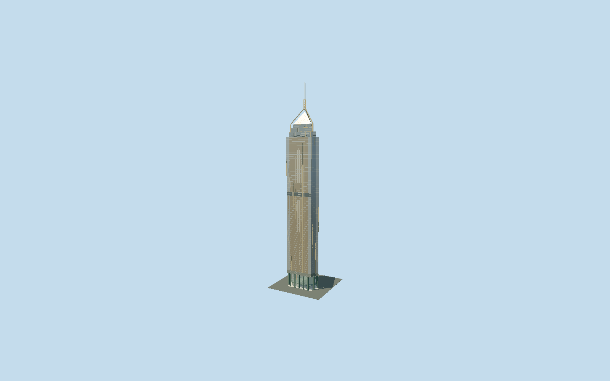

# Central Plaza

Hong Kong’s three-sided gold-and-silver tower with mapped reentrant corners, an open base of green granite columns, ceramic-frit cat-scratch facade patterns, stepped mechanical crown, triangular glazed observation pyramid and open three-legged mast support.

## Evidence and reconstruction

Published dimensions and reconstructed details are separated in spec.json. Primary references:

- [Reference](https://www.centralplaza.com.hk/wp-content/uploads/2025/07/Technical-Fitting-out-Guides-CP-MK-FRD010-Rev.8.pdf)
- [Reference](https://www.arup.com/globalassets/downloads/arup-journal/the-arup-journal-1993-issue-4.pdf)
- [Reference](https://www.centralplaza.com.hk/)
- [Reference](https://www.openstreetmap.org/way/27087018)
- [Reference](https://www.openstreetmap.org/way/1047690918)

No third-party geometry, photograph or bitmap texture is embedded. Shared surface graphs come from the central library; vertex tints carry model colors. Glazing uses PBR materials; transparent surfaces are declared per model.

## Model and axes

23,293 triangles; 50,487 vertices; 4 material groups; 2,099,748 bytes. Native bounds: -31.870, 0.000, -27.486 to 31.870, 374.300, 28.057. Source hash: `sha256:84ec97ae5d6992449e047e59b7348b1f2dd6d25a81a515254c28f8ceb3104a72`.

{"up":"+Y","longitudinal":"+X east-northeast","front":"+Z south-southeast Gloucester Road frontage","origin":"Published street datum 4.1 mPD / mapped tower frame"}

Fresh OSM API on 2026-10-10 confirms exact Q112640 whole 27087018 and eight separately retained crown/roof/mast geometries, unchanged from independent map-parts. Signed heading 0.076907698117 puts +X east-northeast and +Z south-southeast; the broad +Z face fronts Gloucester Road. Owner 2025 guide independently describes south, northwest and northeast facades; Arup 1993 north-arrow site/first-floor plans corroborate the clipped triangular compass phase. Native mast center [-0.01329,4.79924] is independently checked against part 1047690918. Source Y=0 is published 4.1 mPD street datum, not sea level; 378.4 mPD tip gives 374.3 m above street. Map height 309 m is an envelope-era figure, not mast height. Accept 2 m footprint / 1 degree reconstruction allowance; automatic replacement disabled. Separate adjoining 30.5 m podium, garden, bridges and neighbouring towers are outside tower scope.

## Reproduce

Run `node packages/worldgen/scripts/generate-signature-towers.mjs --ids=N0181` (or add `--check`). The generator preserves manually edited masters by checking their baseline hashes. Import through the standard authored-model workflow with optimization disabled; then capture all QA cameras, including shared-surface views.

## Pending work

- Original 169555-triangle, 17860136-byte master remains exactly reproducible from unchanged recipe. Reviewed source/four browser levels retain signed reentrant triangular plan, gold/silver facade and three frit scratch zones, eighteen open-base green granite columns, inset lobby/balcony, sky-lobby band, separately mapped crown steps, triangular observation pyramid, open three-legged Vierendeel support, four daylight Lightime bands and mast to 374.3 m. Whole backing panels with narrowly overlaid original-phase frit patches and long trim strips replace independently framed cells. Skyline averages facade/trim colour, simplifies round columns and omits collars/rail/door details; district uses shallow transfer/crown strips, omits balcony guardrail and entry frames, and aggregates facade/roof seams; street restores the balcony/entries and finer facade/roof strips; close-up restores fine trim/collars while preserving exterior. Two canonical shared graphs, four near draw groups, zero images; tinted granite approximates Baltic green stone/foundation and painted metal approximates coated gold/silver metal. Lobby glazing is one explicit near transparent group; upper glazing remains opaque. Published heights subtract 4.1 mPD; the mapped 309 m envelope does not set final height. Owner current architectural credit Dennis Lau & Ng Chun Man and original engineer credit Ng Chun Man & Associates are retained as source-specific names. Exact pane/scratch pitch, ring fittings, balcony guardrail, mast taper and entry door schedule are reconstructions. Adjoining podium, bridges, garden, interior art, lettering and time-driven Lightime illumination are excluded. Finite along-ray 1.5/.75/.3/.1 m allowances exclude omitted thin mullions, roof seams and small collars; no global surface-distance bound, physical-device or surveyed grade claim.

This bundle follows the medium-fi standard. Medium-fi appearance and geographic fit are reviewed separately. Hash-bound visual acceptance is recorded separately after capture inspection.
