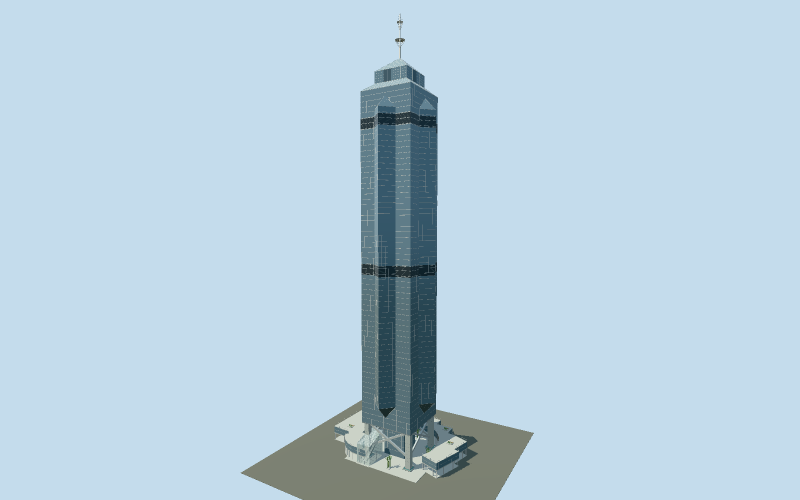

# The Center

Hong Kong’s silver-blue eight-pointed steel tower: four suspended triangular wings with paired half-pyramid terminations, two refuge bands, stepped glass crown and open spoked mast, above exposed braced columns, pools and a mapped curving retail gallery.

## Evidence and reconstruction

Published dimensions and reconstructed details are separated in spec.json. Primary references:

- [Reference](https://www.building.com.hk/comprofile/20120504dln.pdf)
- [Reference](https://www.building.hk/photoessay/center/crfront.html)
- [Reference](https://www.building.hk/photoessay/center/photos/crinside16.html)
- [Reference](https://www.building.hk/photoessay/center/photos/crinside20.html)
- [Reference](https://www.building.hk/photoessay/center/photos/crinside13.html)
- [Reference](https://www.building.hk/photoessay/center/photos/crinside14.html)
- [Reference](https://www.building.hk/photoessay/center/photos/crinside18.html)
- [Reference](https://www.polyucee.hk/cecspoon/lwbt/Guide_Book/Guide_Book_01/Chapter_4b.pdf)
- [Reference](https://www.skyscrapercenter.com/building/building/343)
- [Reference](https://www.e-architect.com/hong-kong/center-skyscraper-hong-kong)
- [Reference](https://www.openstreetmap.org/way/148228888)
- [Reference](https://www.openstreetmap.org/way/148461575)

No third-party geometry, photograph or bitmap texture is embedded. Shared surface graphs come from the central library; vertex tints carry model colors. Glazing uses PBR materials; transparent surfaces are declared per model.

## Model and axes

39,734 triangles; 104,194 vertices; 4 material groups; 4,230,492 bytes. Native bounds: -56.531, 0.000, -43.624 to 48.385, 346.000, 31.540. Source hash: `sha256:0e142d8fc0b589c9ece5e430d8fbeeb25a5f7d723daff12490f090314d13af00`.

{"up":"+Y","front":"+Z southwest toward Queen’s Road","longAxis":"+X southeast along the main frontage"}

Fresh2026-10-10 all19 raw way rings andsix entrance nodes are exact unchanged against independently preserved original local frame. ExactQ130478 tower148228888/address99Queen’s Road and irregular gallery148461575 retain anchor[114.154728212,22.284613112]/heading-.5813691738393112. Original local scaled-Mercator tower projection agrees within.001m numerical rounding. Native+X southeast bearing123.31degrees and+Z southwest bearing213.31degrees register mapped roof-direction213.31/123.31degree facets and separately mapped southwest Queen’s Road entrance10219320513 at[-12.83839,29.96369]m. Primary DLN completed front and plaza/atrium photos plus raw southwest entrance/gallery shape sign90/180degree star ambiguities. Mainstar42.2x42.86m square plus8.92m triangular wings and irregularcurvinggallery are photographic/map reconstruction; accepted wholeenvelope1m/2degreebearing allowance, not cadastral accuracy. All four groundcolumns/pools remain exposed under raised superstructure; gallery is not courtyard fill. Published346m tip/275moccupied and73physicalfloors retained; contractor80storeys is a distinct marketing/construction count. Upperwing270m/roof302m/low35.4m/intermediate courses/refuge bands/BMUdetails unsurveyed reconstructed proportions, not literal coarse raw minimumheight30m/roof300m extrusion. Y0 shared publicapron approximate; no surveyed slopingcurb. No footprint replacement. Neighboring frontage, underground garage, hidden steel core, operational gondolas/nightlight programming/tenant signs excluded.

## Reproduce

Run `node packages/worldgen/scripts/generate-signature-towers.mjs --ids=N0206` (or add `--check`). The generator preserves manually edited masters by checking their baseline hashes. Import through the standard authored-model workflow with optimization disabled; then capture all QA cameras, including shared-surface views.

## Pending work

- Original centerStudy.build remains unchanged and byte-reproduces488748triangles/43189992bytes. Separate reviewed source retains full square tower/four projecting triangular wings with genuinely sloping lower/upper halfpyramids, two refuge bands, stepped glazed crown/BMUdoors,346m closed mast and two thin conical open-around-mast collars/spokes/ladder, four fullheightexposedcolumns/eightXbraces/pools/open undercroft, C-shaped irregulargallery with atrium slabcutout and southwest glazed entry/escalators, bamboo gardens/steps/benches. Flatcontinuousglass and projectedmullion/transom/neon strips replace repeated closedpane beams, near2.86m bays ratherthan1.43m;61main/55wing course pitch retained with explicit141–149/248–256m refuge intervals and.38m sampled louvers. Roofgrid is3m near, trianglepane bands3m; mast24side/24x6tori replace40side/72x10, collars24side replace72 and ladderrungs.64m replace.32m. Near bamboo3stems/4pairedleaftriangles perplant and chunky roofshoots replace7dense stems/allnodes/tiny leaves. Wood/foliage/recess share tinted granite/paintedmetal to keepfourgroups alongside opaque vision and52percent BLEND entryglass; bamboo grain/bench species and glazing transparency remain stylized. Skyline omits facade/course/neon/louver/railings/columnjoints/steps/bamboo/benches/mastspokes/ladder/poolcoping/entrydoorframes, retains four upper mast braces/all principal volumes, refuge bands, openbase/braces/gallerycourt and entry/escalatorbeams; gallery collinearjogs narrowed under.4m; one5.5–11.3m raised gallery volume replaces separated slabs while retaining atrium slabcutout/courtyard and glassouterwall; supports sampled only on16m-plus edges. District restores full-width32m courses/2.4m louvers,8sidemast/collars/fourspokes/four upper braces/two coarse arrival steps, four coarseplantclusters, supports sampled on8m-plus gallery edges and dark BMUdoor patches. Street restores8.58m bays/12m courses/.8m louvers,12sidemast/collars and twelve spokes, everysecond escalatorstep and sampledgalleryrails. Close-up restores nearpitch/pane rhythm/24sidemast/12spokes/.64mladder and everyescalatorstep. Mainstar/galleryrelativegrades/pools/finefacadegrid/intermediateheights/atriumfitout/BMUdoorphase unsurveyed; physicaldevice/densecity timings and globalerrorbounds unmeasured. One reconstructed northeast bench/planter is relocated from[31,-28] to[26,-31]m so its whole base rests within independently mapped gallery roof; original recipe position remains preserved. Skyline mast is five-sided and entryglass is palette-baked opaque, while later levels preserve52percent transparent atrium. District/street retain both long mast ladder rails; rungs remain close-up only. District neon housings are sampled everysecond retainedcourse.

This bundle follows the medium-fi standard. Medium-fi appearance and geographic fit are reviewed separately. Hash-bound visual acceptance is recorded separately after capture inspection.
