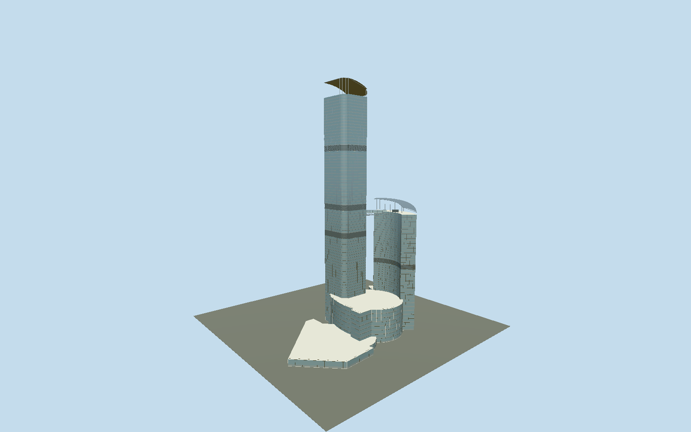

# Nina Tower

Tall northwest glazed tower, crescent-shaped southeast hotel tower, open asymmetric sail crowns, silver refuge bands, curved enclosed skybridge and curved main podium with separate low western bus-terminal wing.

## Evidence and reconstruction

Published dimensions and reconstructed details are separated in spec.json. Primary references:

- [Reference](https://www.skyscrapercenter.com/building/nina-tower/421)
- [Reference](https://www.skyscrapercenter.com/complex/249)
- [Reference](https://www.ninahotelgroup.com/media/iy4ffnai/240315-tww-fact-sheet-en.pdf)
- [Reference](https://www.tpb.gov.hk/en/papers/TPB/TWK/A_TW_497_RV/A_TW_497_RV_Annex%20b.pdf)
- [Reference](https://www.sika.com/dms/getdocument.get/dfedde96-0ea7-4344-97d8-59e1ff66e9a1/glo-sika-concrete-highrise-buildings-references.pdf)

No third-party geometry, photograph or bitmap texture is embedded. Shared surface graphs come from the central library; vertex tints carry model colors. Glazing uses PBR materials; transparent surfaces are declared per model.

## Model and axes

44,980 triangles; 133,068 vertices; 6 material groups; 5,333,716 bytes. Native bounds: -126.524, 0.000, -20.639 to 69.041, 320.395, 95.758. Source hash: `sha256:600b682dd9294c9f3de721e4e95fcabc963b6fab0741d745bacd56b9f56bef38`.

{"up":"+Y","longitudinal":"+X ENE along tall north facade","front":"-Z NNW with independent tall northwest / hotel southeast layout","origin":"Mapped tall footprint area centroid at approximate pavement"}

The geographic proposal uses exact-QID OpenStreetMap evidence. Map-derived orientation and estimated architectural details require real-site visual review; preview eligibility is distinct from geographic/fidelity approval. Map attribution: © OpenStreetMap contributors, ODbL-1.0.

## Reproduce

Run `node packages/worldgen/scripts/generate-signature-towers.mjs --ids=nina_tower` (or add `--check`). The generator preserves manually edited masters by checking their baseline hashes. Import through the standard authored-model workflow with optimization disabled; then capture all QA cameras, including shared-surface views.

## Pending work

- Preserved original ninaTowerStudy.encodeAssembly reconstitutes 3554848 bytes /128948 expanded triangles (16 parts/11956 placements), including its prior provisional southwest hotel placement. Reviewed source and four browser levels correct the actual mapped tall northwest, curved crescent hotel southeast, connected curved bridge and separately lower western podium. Polygon caps use concave triangulation rather than a center fan; the hotel inner curve and courtyard cut-ins are retained. Tall occupied/top 301.1/320.4 m and shorter occupied/top 153/170 m are working geometric datums; mapped 318 m, registry heights, planning 72/36 tower plus 8 podium storeys, 80 registry above-ground floors and hotel 87F/41F labels are separate records. Eight podium rows extend to mapped 42 m, replacing provisional 32.8 m; row heights/refuge allocations, entrance four leaves, canopy, generic enclosed interiors, sail curves/high sides/columns/equipment and bridge 151.7 m deck/3 m trusses are reconstructed, not measured. Facades keep flat glass panels, silver horizontal transoms, vertical fins and multi-row refuge bands. Close subdivides long edges at about 3 m; street retains floor rows with coarser bays; district groups four tower floors and two podium groups; skyline uses only silhouette/refuge bands. Far levels omit transparent doors and bridge glazing while retaining the curved bridge volume and both open sail crowns. Three shared graphs (stainless, concrete, granite) plus opaque/52-percent clear glass and recess tint form six near groups with one BLEND group and zero embedded images. Full mall fitout/signage, exact roof equipment, underground floors, road footbridges and Nina Mall 2 are excluded. Source photographs and plans are linked references only. Physical laptop/phone and dense-city timings remain pending.

This bundle follows the medium-fi standard. Medium-fi appearance and geographic fit are reviewed separately. Hash-bound visual acceptance is recorded separately after capture inspection.
