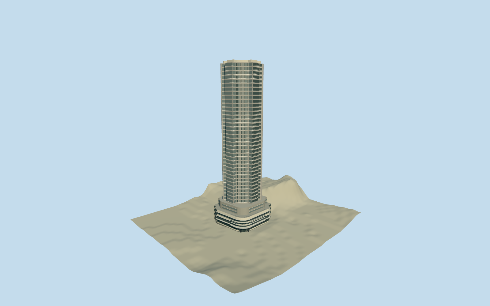

# Old Wan Chai Market Building

The 1937 Streamline Moderne entrance of Old Wan Chai Market retained beneath the pale-grey One Wanchai tower.

Authoring state: **review-in-qa.json**. Current completion evidence is in [qa.json](qa.json) and the [completion ledger](../../../../qualla-structures/batches/qualla-004.PROGRESS.md).

- [Old Wanchai Market Building](https://qualla.com/old-wanchai-market-building/)

The preserved market corner, canopies, window ribbons and piers are scaled from the surveyed current plan and the 2007 Qualla frontage photograph. The photo predates adaptive reuse, so current entrance glazing and some small façade details are interpreted.

The attached tower uses Lands Department height and footprint dimensions with medium-fidelity façade bands. Detailed lift facilities, apartment interiors, retail fittings and signs are outside scope.

Build: `node content/worldgen/source/places/we/wec/old_wanchai_market_building/models/generate-old-wanchai-market-building.mjs`. Add `--check` to verify exact regeneration. 12376 triangles; 6 materials; no embedded photographs.
