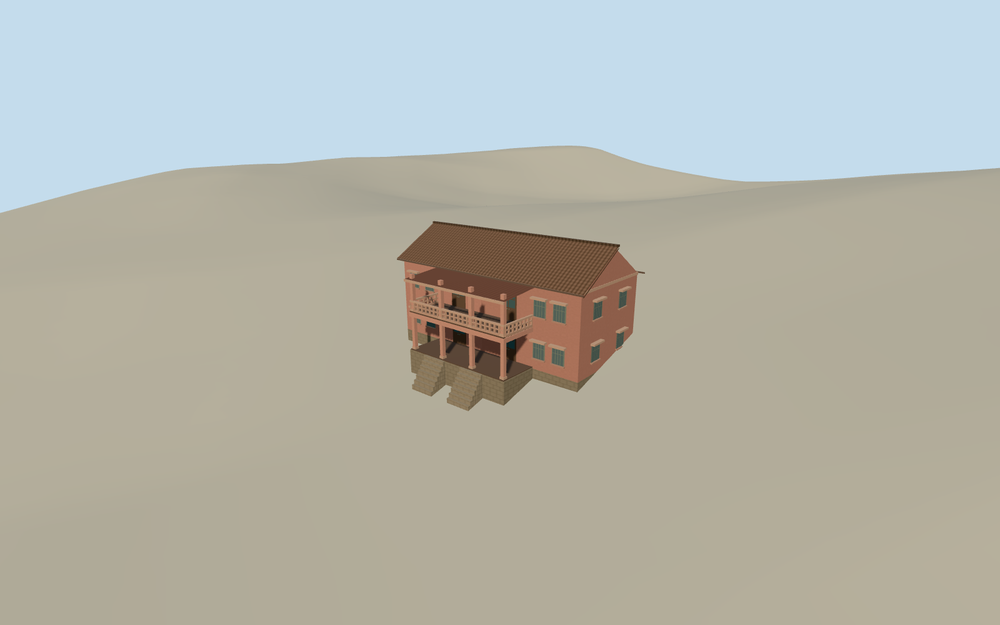

# Red House, Tuen Mun

Hung Lau at Tuen Mun, with a pitched red plaster main house, paired living units, a southeast verandah with pierced masonry screens, and the attached two-storey rear annex.

Authoring state: **review-in-qa.json**. Current completion evidence is in [qa.json](qa.json) and the [completion ledger](../../../../qualla-structures/batches/qualla-003.PROGRESS.md).

- [Red House (Hong Kong)](https://qualla.com/red-house-hong-kong/)

The exterior follows the February 2017 heritage description and the twelve-point mapped outline. The map controls the house, verandah and rear projections.

Floor levels, roof pitch, window spacing, screen-block pattern and color are approximate interpretations of the written evidence.

The steep natural grade remains in its original source grid. Thresholds, footings and the short approach stairs use modeled elevations.

The reconstruction covers the standing house, verandah and attached service annex. The surrounding former farm is represented by the original terrain.

Build: `node content/worldgen/source/places/we/wec/red_house_hong_kong/models/generate-red-house-hong-kong.mjs`. Add `--check` to verify exact regeneration. 2442 triangles; 5 materials; no embedded photographs.
