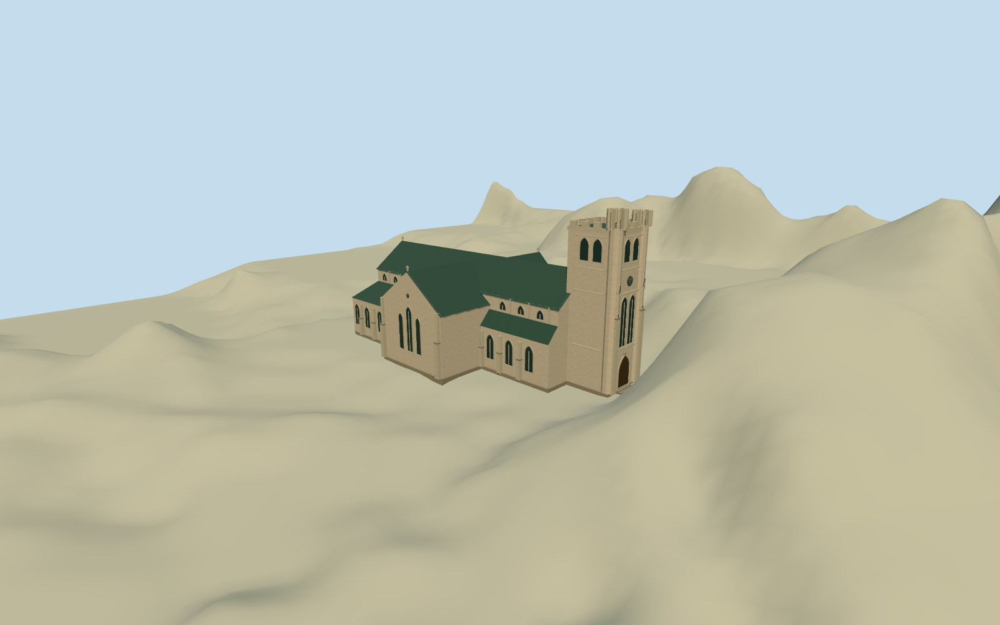

# St John's Cathedral (Hong Kong)

Garden Road’s 1849 Gothic cathedral with a square crenellated west tower, dark green crossed roofs, roughcast walls and granite dressings.

Authoring state: **review-in-qa.json**. Current completion evidence is in [qa.json](qa.json) and the [completion ledger](../../../../qualla-structures/batches/qualla-004.PROGRESS.md).

- [St John's Cathedral (Hong Kong)](https://qualla.com/st-john-s-cathedral-hong-kong/)

Current exterior of the principal cathedral. Separately mapped precinct facilities, adjacent towers and interior fittings are outside scope.

Story photographs fix proportions and materials. Tower height, roof terraces, stone carvings and traceries are visually estimated.

Build: `node content/worldgen/source/places/we/wec/st_john_s_cathedral_hong_kong/models/generate-st-john-s-cathedral-hong-kong.mjs`. Add `--check` to verify exact regeneration. 8550 triangles; 6 materials; no embedded photographs.
