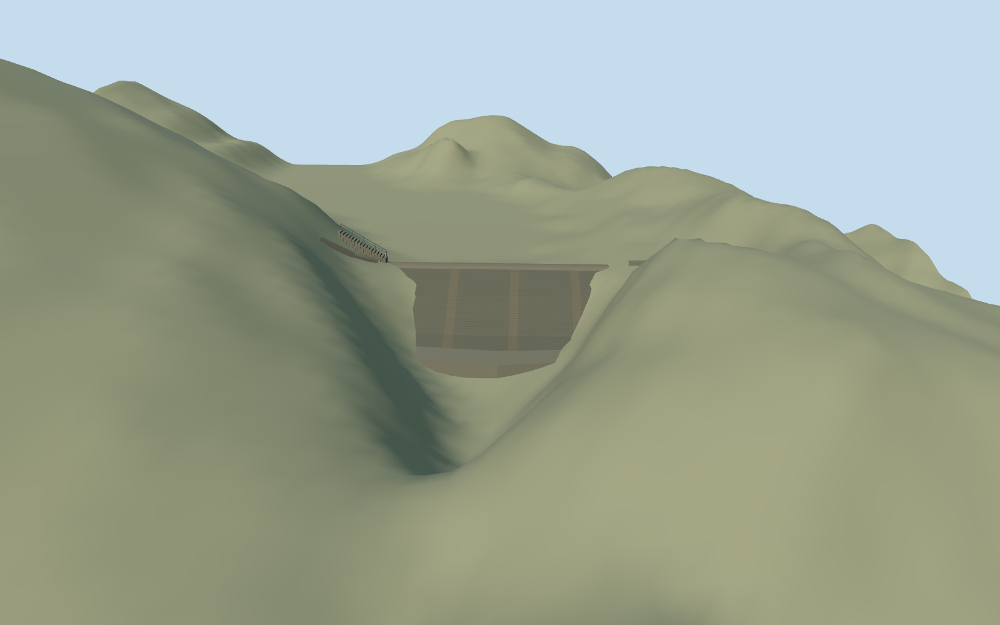

# Tai Tam Byewash Reservoir Dam

Tai Tam Byewash Reservoir Dam. The continuous dark granite spillway, rounded overflow crest, two rubble abutments and the west gauge approach.

Authoring state: **review-in-qa.json**. Current completion evidence is in [qa.json](qa.json) and the [completion ledger](../../../../qualla-structures/batches/qualla-003.PROGRESS.md).

- [Tai Tam Waterworks Heritage Trail](https://qualla.com/tai-tam-waterworks-heritage-trail/)

The source map anchors the central spillway and downstream apron. The official overall length is about 50 m. Wing wall junctions, individual masonry courses, exact crest shape and mounting details are estimates.

The published full water level is 151.4 m HKPD. The visual crest is registered 1.25 m higher in the coarse elevation preview to keep the coping visible against the sampled dam surface. The original elevation field is unchanged and the downstream toe and hidden foundation are approximate.

The subsidiary dam valve house and the upstream aqueduct are distinct geographic structures. The surrounding reservoir surface belongs to the scene.

Build: `node content/worldgen/source/places/we/wec/tai_tam_byewash_reservoir_dam/models/generate-tai-tam-byewash-reservoir-dam.mjs`. Add `--check` to verify exact regeneration. 1546 triangles; 5 materials; no embedded photographs.
