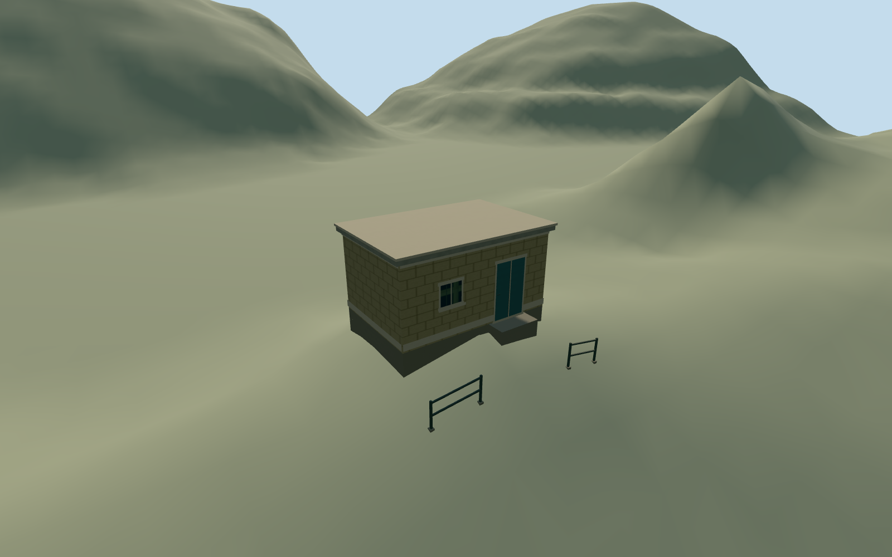

# Tai Tam Byewash Reservoir Valve House

Tai Tam Byewash Reservoir’s small 1904 granite valve house with its flat slab, plain service entrance and safety rails beside the subsidiary dam.

Authoring state: **review-in-qa.json**. Current completion evidence is in [qa.json](qa.json) and the [completion ledger](../../../../qualla-structures/batches/qualla-003.PROGRESS.md).

- [Tai Tam Waterworks Heritage Trail](https://qualla.com/tai-tam-waterworks-heritage-trail/)

The roof height, edge profile, door and window proportions, glazing and the short rail section are estimates based on the written descriptions. The exterior walls follow the original mapped rectangle.

The 5 m terrain supports approximate contact along the narrow dam path. The building has a terrain-following foundation below the estimated main floor.

The independent spillway dam and the remainder of the subsidiary dam are outside this small building model.

Build: `node content/worldgen/source/places/we/wec/tai_tam_byewash_reservoir_valve_house/models/generate-tai-tam-byewash-reservoir-valve-house.mjs`. Add `--check` to verify exact regeneration. 234 triangles; 6 materials; no embedded photographs.
