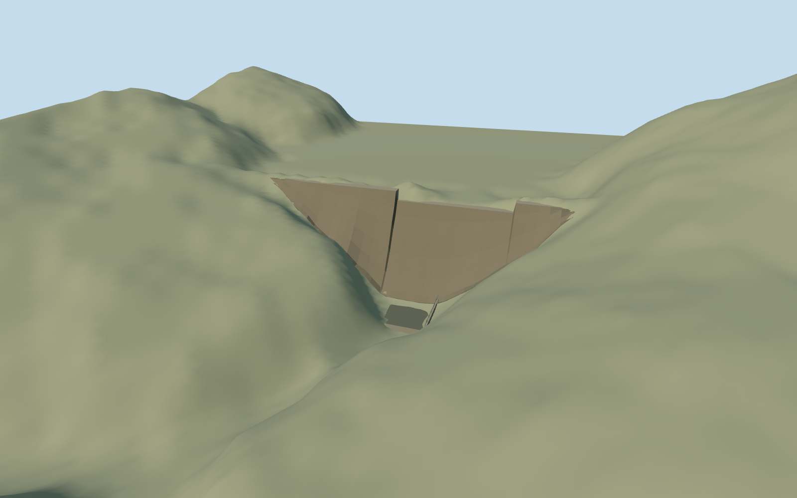

# Tai Tam Intermediate Reservoir Dam

Tai Tam Intermediate Reservoir Dam with a lowered north spillway and downstream concrete stilling basin.

Authoring state: **review-in-qa.json**. Current completion evidence is in [qa.json](qa.json) and the [completion ledger](../../../../qualla-structures/batches/qualla-003.PROGRESS.md).

- [Tai Tam Waterworks Heritage Trail](https://qualla.com/tai-tam-waterworks-heritage-trail/)

The published reservoir full water elevation of 58.17 m HKPD was used as the approximate lowered overflow height. The 1977 safety works lowered the north spillway by nine feet. The exact location and lengths of these crest changes are estimates.

The basin edge, depth and guardrails are interpreted from the local grade and written records. No dated water surface is represented. The valve house and its access bridge are reserved for the independent valve-house model.

Build: `node content/worldgen/source/places/we/wec/tai_tam_intermediate_reservoir_dam/models/generate-tai-tam-intermediate-reservoir-dam.mjs`. Add `--check` to verify exact regeneration. 1320 triangles; 5 materials; no embedded photographs.
