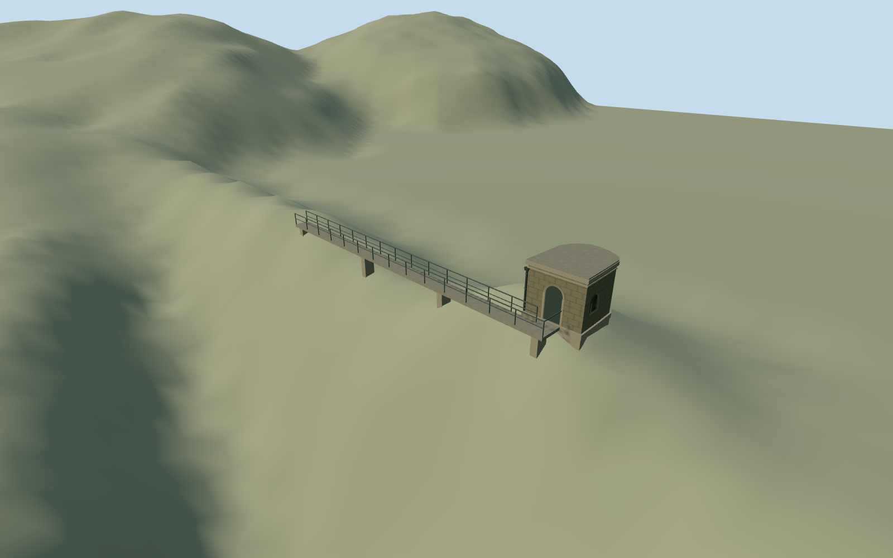

# Tai Tam Intermediate Reservoir Valve House

Rounded granite Intermediate Reservoir Valve House with a projecting plinth, semicircular openings, iron downpipe and footbridge along the crest.

Authoring state: **review-in-qa.json**. Current completion evidence is in [qa.json](qa.json) and the [completion ledger](../../../../qualla-structures/batches/qualla-003.PROGRESS.md).

- [Tai Tam Waterworks Heritage Trail](https://qualla.com/tai-tam-waterworks-heritage-trail/)

The government map fixes the valve-house footprint. Floor and roof heights, arched opening spacing and pipe details are estimates from the terrain and official appraisal.

The approach path endpoint and documented footbridge support an estimated deck run along the crest. Its precise alignment, steel details and support spacing are not surveyed.

The original 5 m survey includes the raised valve structure and sometimes meets the modeled walls above the plinth in the terrain preview.

Build: `node content/worldgen/source/places/we/wec/tai_tam_intermediate_reservoir_valve_house/models/generate-tai-tam-intermediate-reservoir-valve-house.mjs`. Add `--check` to verify exact regeneration. 947 triangles; 6 materials; no embedded photographs.
