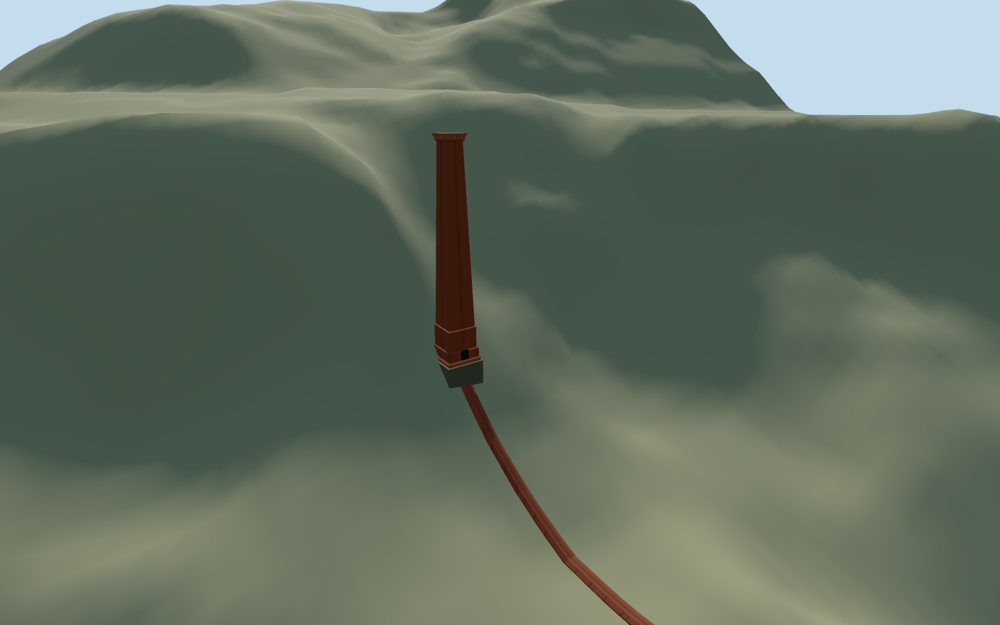

# Tai Tam Tuk Raw Water Pumping Station Chimney Shaft

Square tapered red-brick chimney of Tai Tam Tuk’s pumping station with corbelled coping and the mapped downhill flue.

Authoring state: **review-in-qa.json**. Current completion evidence is in [qa.json](qa.json) and the [completion ledger](../../../../qualla-structures/batches/qualla-003.PROGRESS.md).

- [Tai Tam Waterworks Heritage Trail](https://qualla.com/tai-tam-waterworks-heritage-trail/)

The heritage survey supplies the chimney height. The width fitted within the marked base, top width, stepped cornice details and the small inspection aperture are estimates.

Only the visible crown of the inclined flue and exposed base are represented. The exact exterior exposure of the brick conduit and its connection into the pumping station are approximate.

The original 5 m terrain is preserved. The ground can obscure individual brick steps and local foundation joints.

Build: `node content/worldgen/source/places/we/wec/tai_tam_tuk_raw_water_pumping_station_chimney_shaft/models/generate-tai-tam-tuk-raw-water-pumping-station-chimney-shaft.mjs`. Add `--check` to verify exact regeneration. 504 triangles; 4 materials; no embedded photographs.
