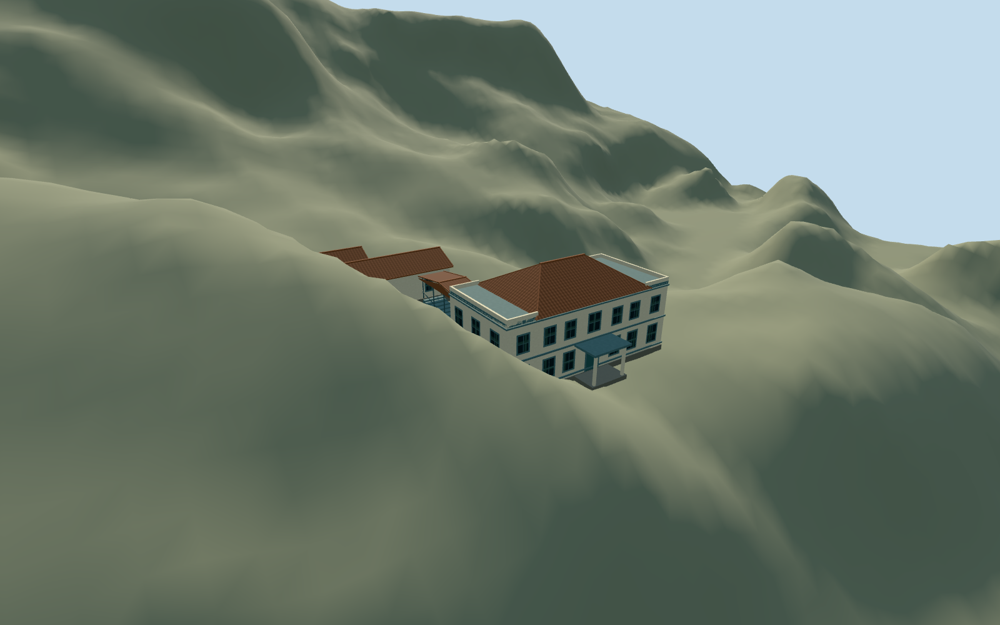

# Tai Tam Tuk Raw Water Pumping Station Senior Staff Quarters

Senior Staff Quarters at the Tai Tam Tuk pumping station, with a white and blue seaward house and roofed access to the servants’ quarters.

Authoring state: **review-in-qa.json**. Current completion evidence is in [qa.json](qa.json) and the [completion ledger](../../../../qualla-structures/batches/qualla-003.PROGRESS.md).

- [Tai Tam Waterworks Heritage Trail](https://qualla.com/tai-tam-waterworks-heritage-trail/)

The main footprint follows the named OpenStreetMap building. The official heritage boundary establishes the immediate site and supports the location of associated minor volumes. Where no independent footprint survives, the minor-volume positions are estimates inside that area.

The main heights, eaves, paint tones and position of individual windows, stairs and service fittings are estimates from the written descriptions and mapped dimensions. Closed interiors and below-grade service rooms are outside the exterior scope.

The original 5 m terrain is preserved. Fine platform and paving geometry may differ from the survey.

Build: `node content/worldgen/source/places/we/wec/tai_tam_tuk_raw_water_pumping_station_senior_staff_quarters/models/generate-tai-tam-tuk-raw-water-pumping-station-senior-staff-quarters.mjs`. Add `--check` to verify exact regeneration. 1644 triangles; 8 materials; no embedded photographs.
