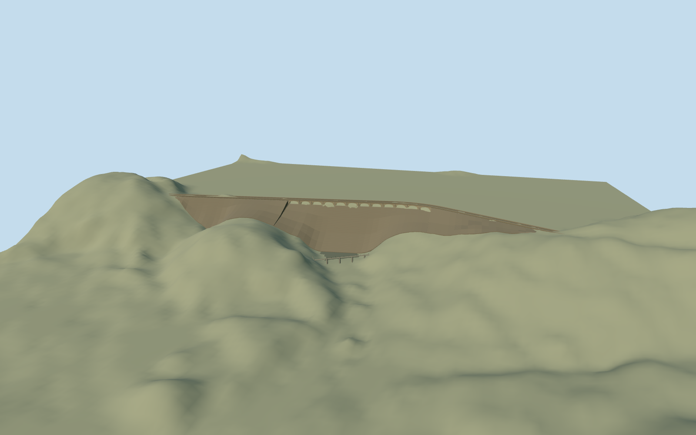

# Tai Tam Tuk Reservoir Dam

Tai Tam Tuk Reservoir masonry dam with its continuous curved crest road, twelve arched bays, ten modified siphons and the mapped downstream pool crossing.

Authoring state: **review-in-qa.json**. Current completion evidence is in [qa.json](qa.json) and the [completion ledger](../../../../qualla-structures/batches/qualla-003.PROGRESS.md).

- [Tai Tam Waterworks Heritage Trail](https://qualla.com/tai-tam-waterworks-heritage-trail/)

Road axis and downstream footbridge use independent mapped centerlines. The 5 m survey establishes the crest datum and local valley relief. Individual bay spacing, siphon boxes and local abutment treatments are estimates.

The records describe complete engineering height including foundations. The visible model follows the ground survey for the downstream face and omits buried portions. The 35.95 m HKPD full water elevation anchors the spillway section.

The valve house and memorial stone are separate assets. The basin outline, water level and visible engineering finishes are interpreted from the native terrain and written engineering sources.

Build: `node content/worldgen/source/places/we/wec/tai_tam_tuk_reservoir_dam/models/generate-tai-tam-tuk-reservoir-dam.mjs`. Add `--check` to verify exact regeneration. 3713 triangles; 5 materials; no embedded photographs.
