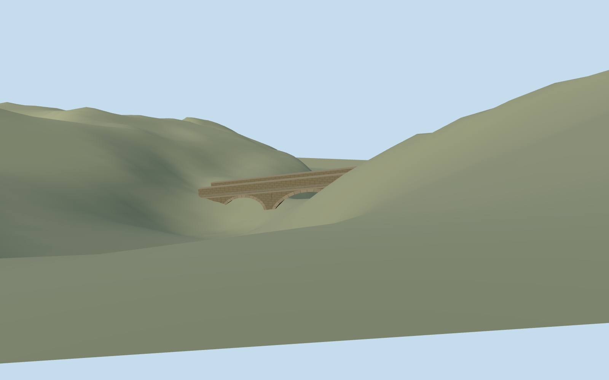

# Tai Tam Tuk Reservoir Masonry Bridge 3

Historic Tai Tam Tuk Reservoir masonry bridge 3, with 3 granite-faced arches and a stone parapet.

Authoring state: **review-in-qa.json**. Current completion evidence is in [qa.json](qa.json) and the [completion ledger](../../../../qualla-structures/batches/qualla-003.PROGRESS.md).

- [Tai Tam Waterworks Heritage Trail](https://qualla.com/tai-tam-waterworks-heritage-trail/)

The heritage boundary and road trace establish the location and plan. Exact pier stations, spring heights, parapets and visible foundations are estimates.

The historical construction report records span groups for the three larger structures. The model associates those dimensions with this footprint by shore order and scale. The sequence of unequal openings is an estimate.

The 5 m elevation grid represents original surveyed ground and the reservoir surface. Submerged foundations and channel depths are outside the available data. Near-deck apparent sculpting in the elevation model is kept in the preview.

Build: `node content/worldgen/source/places/we/wec/tai_tam_tuk_reservoir_masonry_bridge_3/models/generate-tai-tam-tuk-reservoir-masonry-bridge-3.mjs`. Add `--check` to verify exact regeneration. 1384 triangles; 4 materials; no embedded photographs.
