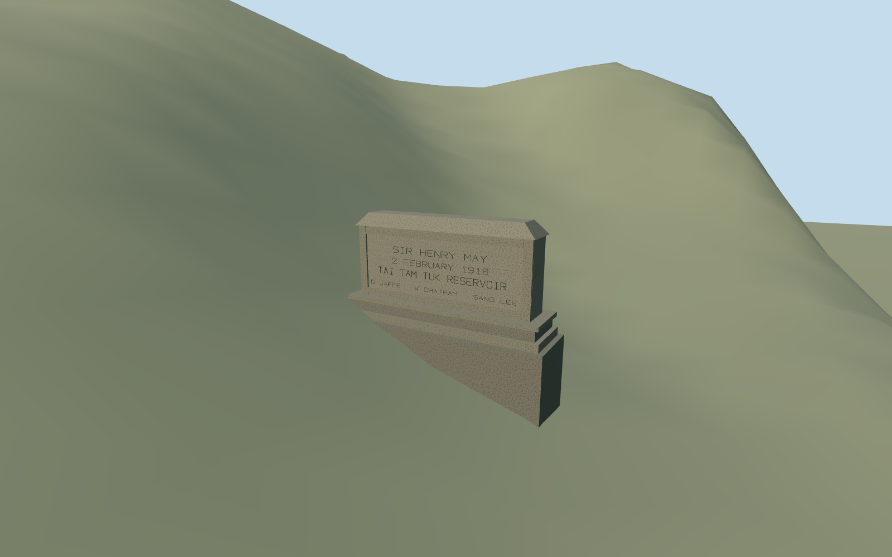

# Tai Tam Tuk Reservoir Memorial Stone

The 1918 Tai Tam Tuk Reservoir Memorial Stone with a stepped granite base, splayed cap and inset dedication.

Authoring state: **review-in-qa.json**. Current completion evidence is in [qa.json](qa.json) and the [completion ledger](../../../../qualla-structures/batches/qualla-003.PROGRESS.md).

- [Tai Tam Waterworks Heritage Trail](https://qualla.com/tai-tam-waterworks-heritage-trail/)

The official map fixes the memorial setting. Stone, base and cap dimensions and their position within the heritage area are estimates.

The closeup models use selected names, date and the reservoir title from the documented inscription. The carved surface represents the historical lettering at medium fidelity.

Build: `node content/worldgen/source/places/we/wec/tai_tam_tuk_reservoir_memorial_stone/models/generate-tai-tam-tuk-reservoir-memorial-stone.mjs`. Add `--check` to verify exact regeneration. 3598 triangles; 2 materials; no embedded photographs.
