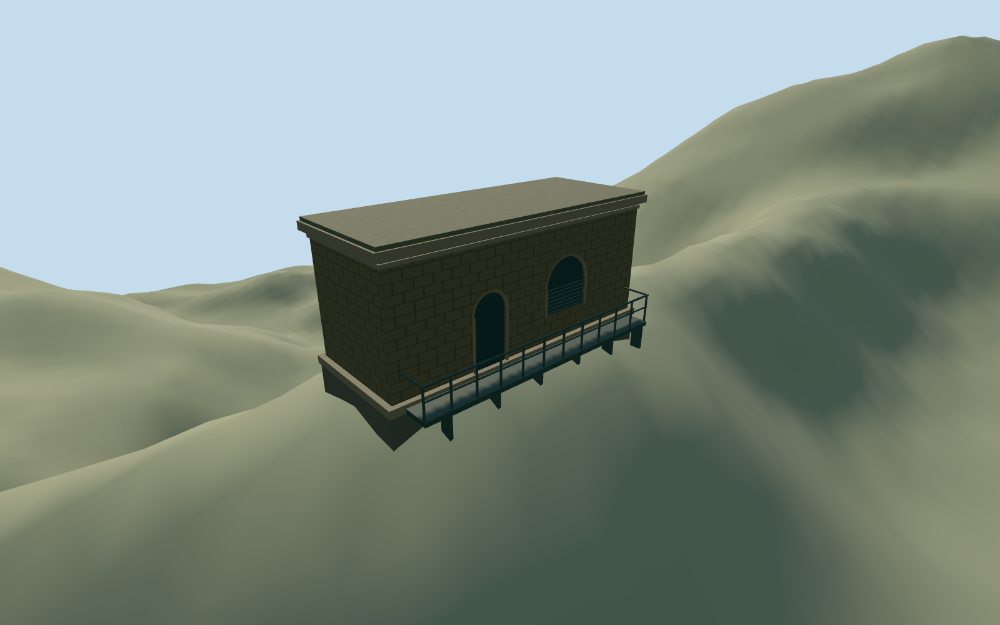

# Tai Tam Tuk Reservoir Valve House

Long granite Tai Tam Tuk Valve House with a water-side steel catwalk, moulded flat roof and blocked road-side openings.

Authoring state: **review-in-qa.json**. Current completion evidence is in [qa.json](qa.json) and the [completion ledger](../../../../qualla-structures/batches/qualla-003.PROGRESS.md).

- [Tai Tam Waterworks Heritage Trail](https://qualla.com/tai-tam-waterworks-heritage-trail/)

The model follows the dual mapped footprint. Roof height, the position and number of individual openings and the catwalk dimensions are estimates.

The original 5 m terrain and the native road axis constrain the adjacent crest. The pier masonry and water-side foundation level are approximate.

Build: `node content/worldgen/source/places/we/wec/tai_tam_tuk_reservoir_valve_house/models/generate-tai-tam-tuk-reservoir-valve-house.mjs`. Add `--check` to verify exact regeneration. 697 triangles; 5 materials; no embedded photographs.
