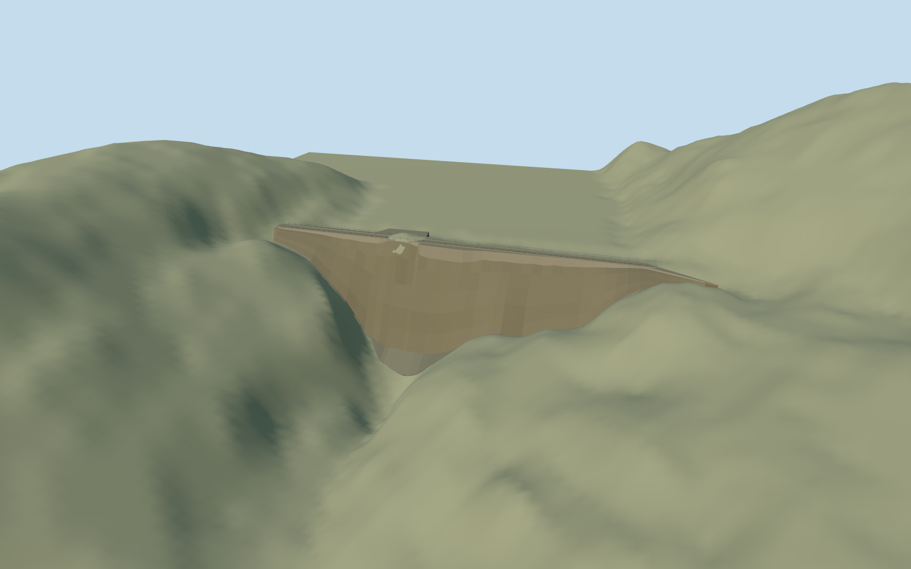

# Tai Tam Upper Reservoir Dam

Tai Tam Upper Reservoir Dam, a tall granite-faced gravity wall with dressed crest and inspection rails. The downstream slope leads into the mapped valley.

Authoring state: **review-in-qa.json**. Current completion evidence is in [qa.json](qa.json) and the [completion ledger](../../../../qualla-structures/batches/qualla-003.PROGRESS.md).

- [Tai Tam Waterworks Heritage Trail](https://qualla.com/tai-tam-waterworks-heritage-trail/)

The guide gives a 121.9 m main dam, and the appraisal gives about 150 m including its broader extent. The mapped slope and shared shoreline guide the model. The inspection walkway and individual course details remain estimated.

The published full water elevation is 152.31 m HKPD. The top and toe follow the unmodified original terrain and documented gravity section. The 1897 change is represented by the estimated raised crest and pale coping.

The historic valve house is an independently placed structure on part of the crest. The separate overflow works are beyond this dam’s physical footprint.

Build: `node content/worldgen/source/places/we/wec/tai_tam_upper_reservoir_dam/models/generate-tai-tam-upper-reservoir-dam.mjs`. Add `--check` to verify exact regeneration. 3668 triangles; 5 materials; no embedded photographs.
