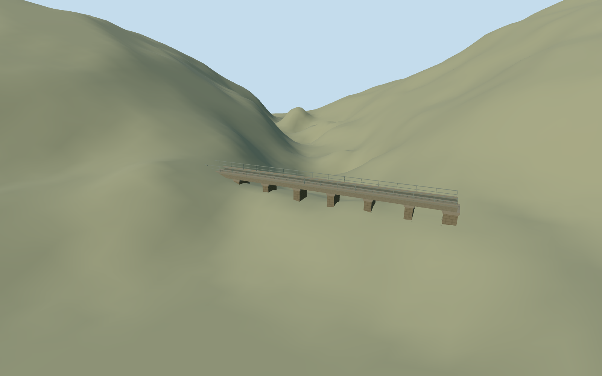

# Tai Tam Upper Reservoir Masonry Aqueduct

Tai Tam Upper Reservoir Masonry Aqueduct. A narrow water channel carried across the former stream bed by a flat slab and repeated stone piers.

Authoring state: **review-in-qa.json**. Current completion evidence is in [qa.json](qa.json) and the [completion ledger](../../../../qualla-structures/batches/qualla-003.PROGRESS.md).

- [Tai Tam Waterworks Heritage Trail](https://qualla.com/tai-tam-waterworks-heritage-trail/)

The distinct mapped centerline and labeled location register the aqueduct. Trough depth, width, pier spacing, colors and embankment junctions are estimates from the distant cleared view and written descriptions.

The 5 m terrain field was preserved. The shallow fall of the trough and the foundations beneath the channel are approximate.

The perpendicular masonry road bridge and the Byewash spillway are separate structures.

Build: `node content/worldgen/source/places/we/wec/tai_tam_upper_reservoir_masonry_aqueduct/models/generate-tai-tam-upper-reservoir-masonry-aqueduct.mjs`. Add `--check` to verify exact regeneration. 1452 triangles; 4 materials; no embedded photographs.
