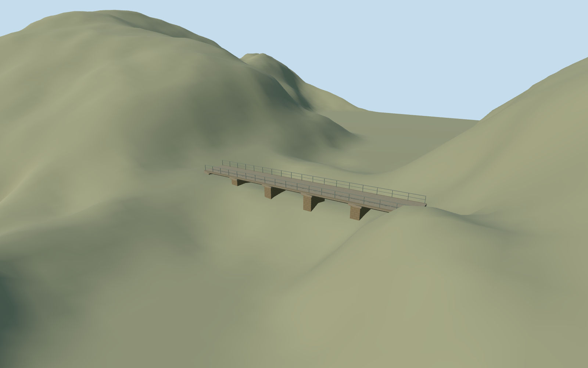

# Tai Tam Upper Reservoir Masonry Bridge

Tai Tam Upper Reservoir Masonry Bridge. A long, low flat concrete slab carried by dressed masonry piers and corbels, with a dark soffit and light metal safety rails.

Authoring state: **review-in-qa.json**. Current completion evidence is in [qa.json](qa.json) and the [completion ledger](../../../../qualla-structures/batches/qualla-003.PROGRESS.md).

- [Tai Tam Waterworks Heritage Trail](https://qualla.com/tai-tam-waterworks-heritage-trail/)

The mapped endpoints set the span and heading. Deck width, pier spacing, surface colors and railing geometry are estimates based on the public-domain photograph and the single-lane context.

The original 5 m terrain field anchors the road approaches. Pier footing depth, deck height and the buried abutment faces are approximate.

Build: `node content/worldgen/source/places/we/wec/tai_tam_upper_reservoir_masonry_bridge/models/generate-tai-tam-upper-reservoir-masonry-bridge.mjs`. Add `--check` to verify exact regeneration. 1668 triangles; 4 materials; no embedded photographs.
