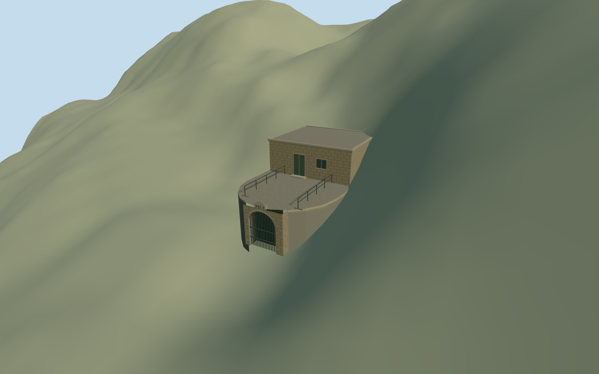

# Tai Tam Upper Reservoir Recorder House and Tunnel Inlet

Tai Tam Upper Reservoir Recorder House and Tunnel Inlet, with a small granite instrument house, curved intake platform, dated pediment and iron grille.

Authoring state: **review-in-qa.json**. Current completion evidence is in [qa.json](qa.json) and the [completion ledger](../../../../qualla-structures/batches/qualla-003.PROGRESS.md).

- [Tai Tam Waterworks Heritage Trail](https://qualla.com/tai-tam-waterworks-heritage-trail/)

The model preserves the mapped curved outline and landward rectangle. House dimensions, house position within that envelope, fittings and limestone/granite tones are estimates from the site description.

The visible intake portal and grate are represented at the edge of the platform. The underground tunnel and historical hydraulic operating height are outside the scope of the exterior model.

The 5 m government terrain field was preserved. The height transition to the original ground, footings, catwalk spans and local platform levels are approximate.

Build: `node content/worldgen/source/places/we/wec/tai_tam_upper_reservoir_recorder_house_and_tunnel_inlet/models/generate-tai-tam-upper-reservoir-recorder-house-and-tunnel-inlet.mjs`. Add `--check` to verify exact regeneration. 1411 triangles; 6 materials; no embedded photographs.
