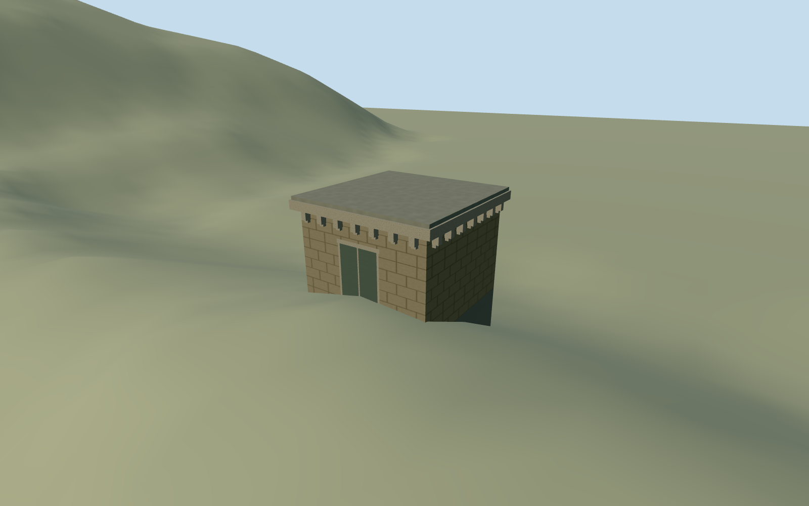

# Tai Tam Upper Reservoir Valve House

The square Upper Reservoir Valve House on the crest of Tai Tam Dam, with rock-faced granite, a projecting corbelled roof and two blocked rear openings.

Authoring state: **review-in-qa.json**. Current completion evidence is in [qa.json](qa.json) and the [completion ledger](../../../../qualla-structures/batches/qualla-003.PROGRESS.md).

- [Tai Tam Waterworks Heritage Trail](https://qualla.com/tai-tam-waterworks-heritage-trail/)

The supporting dam and its small upstream platform are mapped. The valve-house square, height, orientation of openings and masonry detailing are estimates from written descriptions.

The choice of position on the platform and ground connection use the same crest-height reference as the separate Upper Reservoir Dam model.

Build: `node content/worldgen/source/places/we/wec/tai_tam_upper_reservoir_valve_house/models/generate-tai-tam-upper-reservoir-valve-house.mjs`. Add `--check` to verify exact regeneration. 524 triangles; 5 materials; no embedded photographs.
