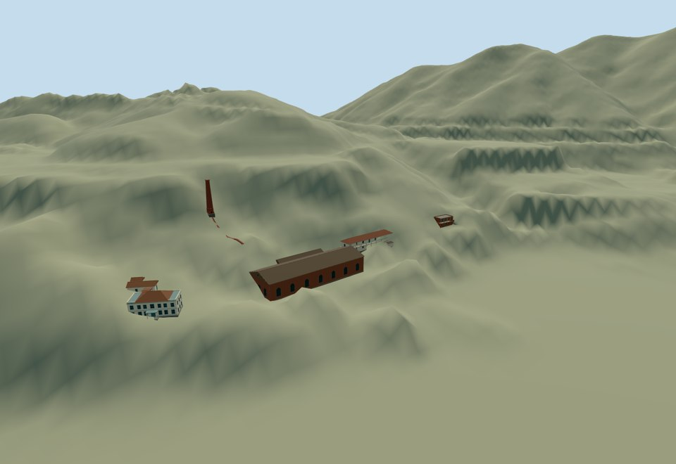

# Tai Tam Waterworks Heritage Trail

The 21 documented trail structures span the Upper, Byewash, Intermediate and Tai Tam Tuk reservoirs and the pumping station compound. Each model uses its own geographic anchor, heading and elevation datum. The structures also appear together here on the original Hong Kong Lands Department terrain. The 8 m overview smooths some local grades. The individual model packages retain finer ground samples.

[Trail story](https://qualla.com/tai-tam-waterworks-heritage-trail/) · [Water Supplies Department guide](https://www.wsd.gov.hk/filemanager/common/pdf/monuments/tai_tam.pdf)

Regenerate the assembly with `node content/worldgen/source/places/we/wec/tai_tam_waterworks_heritage_trail/generate-collection-scene.mjs`. Use `--check` to verify the current assembly.
