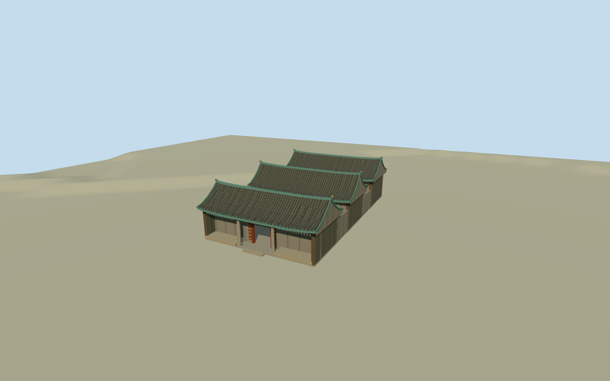

# Tang Ancestral Hall (Ha Tsuen)

Ha Tsuen’s three-bay Tang Ancestral Hall, with timber roofs, Cantonese gray brick, stone columns and two open interior courts.

Authoring state: **review-in-qa.json**. Current completion evidence is in [qa.json](qa.json) and the [completion ledger](../../../../qualla-structures/batches/qualla-004.PROGRESS.md).

- [Tang Ancestral Hall (Ha Tsuen)](https://qualla.com/tang-ancestral-hall-ha-tsuen/)

The 2007 cleared photograph controls the original entry and roof proportions. The restoration facts and official terrain and height measurements set the standing model. The precise ridge relief and rear ornament use simplified geometry.

Build: `node content/worldgen/source/places/we/wec/tang_ancestral_hall_ha_tsuen/models/generate-tang-ancestral-hall-ha-tsuen.mjs`. Add `--check` to verify exact regeneration. 13234 triangles; 6 materials; no embedded photographs.
