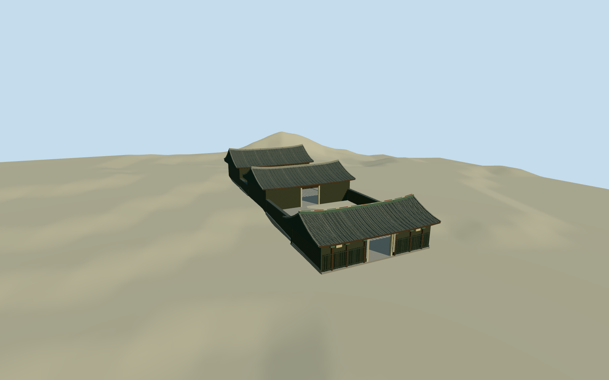

# Tang Chung Ling Ancestral Hall

The Tang Chung Ling Ancestral Hall’s three linked halls, open courtyards, dark brick, and ornamental Cantonese gray tile roofs.

Authoring state: **review-in-qa.json**. Current completion evidence is in [qa.json](qa.json) and the [completion ledger](../../../../qualla-structures/batches/qualla-004.PROGRESS.md).

- [Tang Chung Ling Ancestral Hall](https://qualla.com/tang-chung-ling-ancestral-hall/)

Scope covers the three principal halls, surrounding walls and two internal courtyards. Exterior ancillary buildings outside the named survey polygons are separate.

The exact positions of the courtyard partitions, rear openings and individual ridge ornaments are visually estimated.

Build: `node content/worldgen/source/places/we/wec/tang_chung_ling_ancestral_hall/models/generate-tang-chung-ling-ancestral-hall.mjs`. Add `--check` to verify exact regeneration. 12176 triangles; 7 materials; no embedded photographs.
