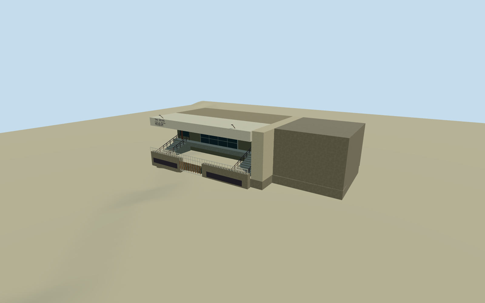

# Tao Heung Food Museum, Fanling (2006)

The original Fanling museum with its cantilever, recessed glass entry, paired front stairs and gated concrete court in October 2006.

Authoring state: **review-in-qa.json**. Current completion evidence is in [qa.json](qa.json) and the [completion ledger](../../../../qualla-structures/batches/qualla-004.PROGRESS.md).

- [Tao Heung Foods of Mankind Museum](https://qualla.com/tao-heung-foods-of-mankind-museum/)

The model is the 2006 Fanling building. The present museum in Fo Tan is at a different address.

Unseen rear elevations, museum signage and fixtures are simplified. Temporary displays and the earlier interior exhibition are outside scope.

Build: `node content/worldgen/source/places/we/wec/tao_heung_fanling_museum/models/generate-tao-heung-fanling-museum.mjs`. Add `--check` to verify exact regeneration. 2306 triangles; 6 materials; no embedded photographs.
