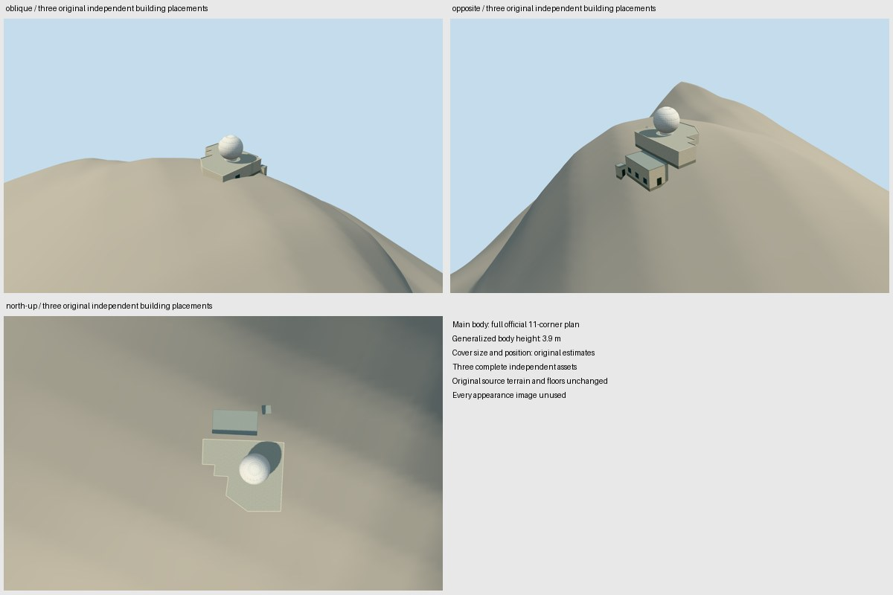

# Tate's Cairn Meteorological Station

Three independently positioned building assets: the complete official eleven-corner main radar building and two separate service buildings. No aggregate GLB or additional site-centroid placement is created. All three source records in the original Hong Kong Lands Department CSDI station query are represented by their whole exterior bodies. The original HKO meteorological-station relation supplies operator context; the station fence and mountain peak are not building footprints. Wikidata Q7687926 is the Qualla story's Tate's Cairn site context, not an invented independent building identity.

The main body retains the official generalized 3.9 m height. Its protective radar enclosure is an original bounded estimate: 8 m outside diameter, an estimated spherical section/collar and a plan-only maximum-clearance position. These are not measured radome dimensions or location. The historical instrument's 4.3 m antenna diameter and 583 m antenna altitude are kept separate from enclosure/building dimensions. Roof sections, finishes, service roles, access detail and exact 2019 appearance continuity remain estimates.

Every appearance image is unused. Qualla's fifteen candidate families and one metadata conflict were screened first; the conflicting hero and unrelated CC0 cross were excluded. Reconstruction uses original numerical building records, primary written instrument facts and clearly disclosed original exterior estimates. No photographs, diagrams, plan images, embedded textures or image-derived descriptions were adopted.

The main model's original 256 m source field was adopted unchanged before deriving assembly poses. Each model retains its own original frame, field, local floor, sections, geometry and QA. Relative poses use original geographic anchors/headings and existing independent source-DEM datums. Official absolute heights are not fitted to the composite hill. Coarse ground causes variable contact, occlusion and exposed foundation sections; it is not a surveyed station platform. No masking, flattening, ground cutout, artificial datum plinth or model-height fitting was applied.

Three current assembly views were inspected in this same authoring pass. North-up and opposite views show all three structures; the first oblique view partly hides the service buildings. Existing individual approvals remain bound. This is an approximate dated 2019 exterior ensemble, with current-world activation disabled in its individual model proposals. Fences, buried services, landscaping and minor equipment/interiors are outside the building reconstruction.

[Qualla story](https://qualla.com/tate-s-cairn/)

Regenerate the assembly with `node content/worldgen/source/places/we/wec/tate_s_cairn/generate-collection-scene.mjs`; `--check` verifies the frozen existing-member inputs and exact saved scene without generating or re-reviewing member geometry.
