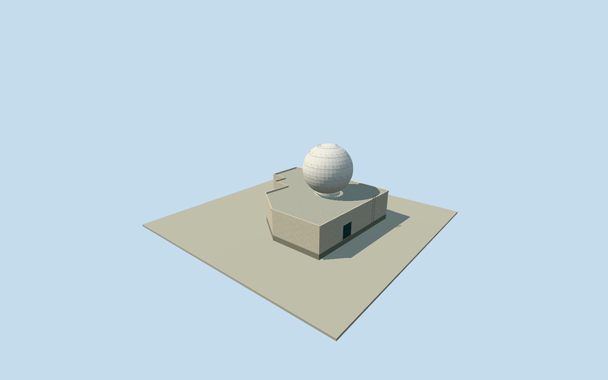

# Tate's Cairn main radar building

Whole original eleven-corner Tate's Cairn radar building, including the main body, every attached footprint arm, an original bounded radome enclosure estimate and estimated roof/access details. The two accepted separate service buildings remain independent and unchanged. Official original CSDI eleven-corner outline and generalized BaseHeight575.9/TopHeight579.8m retained as a3.9m body-height fact; these fields do not measure the radome. Primary HKO written instrument table gives4.3m antenna diameter for the system commencing1994, and583m antenna altitude. Antenna diameter is not radome diameter; altitude is not building height. Radome centre, diameter, section, material and roof/support/access details will be explicit original exterior estimates. Pure plan-only centre chosen before terrain/sections; not measured radar position. Every photograph, figure, diagram, plan image, texture and image-derived description remains unused. Qualla first; conflicting hero and unrelated CC0cross excluded. No closed portal/CAPTCHA/history source route repeated. Whole original11-corner named radar-building body and every attached footprint arm retained. Official generalized BaseHeight575.9m/TopHeight579.8m imply3.9m relative body height, retained exactly. The official flat numerical envelope does not establish the radome section or actual whole-structure top. Main body roof/finish/parapet/door and access details remain original estimates. Radome is an explicit original bounded exterior estimate:8m outside diameter, spherical protective cover truncated at-60degrees latitude,0.6m collar above the generalized body roof. Diameter is chosen as an original enclosure-clearance estimate around the documented4.3m antenna, not an actual radome measurement. Historical antenna system table commenced1994; exact1994-to2019 equipment continuity is not verified. Antenna altitude583m is not used to set model height. Nominal3m diameter and8m centre-placement allowances are not measured bounds. Radome position is the pre-field deterministic maximum-clearance roof-plan point, not a measured instrument position. The full original main-building footprint and heading are fixed first, then own source field, then initial floor/body/cover sections. No satellite, map image, photograph, report figure, diagram, plan image, embedded3Dtexture or image-derived description used. Qualla15families/1conflict screened first; conflicting hero and unrelated CC0cross excluded. Own original256m129x129/16641height source field and raw tile acquired before floor/main sections. Geographic frame/field/floor/main sections remain frozen. Official absolute base exceeds composite source datum by17.0232m; datums/contact are unregistered. No artificial datum plinth, ground cutout, masking, flattening, roof/floor fitting or source refetch. Four authoredLODs retain all11 original plan controls, full attached body, foundation, complete estimated cover/collar and roof outline. Near levels add faceted cover panel divisions, parapet joints, closed service panel and entry frame. Separate accepted service buildings remain independent and closed. Historical2019numerical-body preview/currentWorldEligiblefalse; exact roof/radome appearance continuity unverified.

Authoring state: **review-in-qa.json**. Current completion evidence is in [qa.json](qa.json) and the [completion ledger](../../../../qualla-structures/batches/qualla-002.PROGRESS.md).

- [Tate's Cairn](https://qualla.com/tate-s-cairn/)

Whole original eleven-corner Tate's Cairn radar building, including the main body, every attached footprint arm, an original bounded radome enclosure estimate and estimated roof/access details. The two accepted separate service buildings remain independent and unchanged. Official original CSDI eleven-corner outline and generalized BaseHeight575.9/TopHeight579.8m retained as a3.9m body-height fact; these fields do not measure the radome. Primary HKO written instrument table gives4.3m antenna diameter for the system commencing1994, and583m antenna altitude. Antenna diameter is not radome diameter; altitude is not building height. Radome centre, diameter, section, material and roof/support/access details will be explicit original exterior estimates. Pure plan-only centre chosen before terrain/sections; not measured radar position. Every photograph, figure, diagram, plan image, texture and image-derived description remains unused. Qualla first; conflicting hero and unrelated CC0cross excluded. No closed portal/CAPTCHA/history source route repeated.

Whole original11-corner named radar-building body and every attached footprint arm retained. Official generalized BaseHeight575.9m/TopHeight579.8m imply3.9m relative body height, retained exactly. The official flat numerical envelope does not establish the radome section or actual whole-structure top. Main body roof/finish/parapet/door and access details remain original estimates.

Radome is an explicit original bounded exterior estimate:8m outside diameter, spherical protective cover truncated at-60degrees latitude,0.6m collar above the generalized body roof. Diameter is chosen as an original enclosure-clearance estimate around the documented4.3m antenna, not an actual radome measurement. Historical antenna system table commenced1994; exact1994-to2019 equipment continuity is not verified. Antenna altitude583m is not used to set model height. Nominal3m diameter and8m centre-placement allowances are not measured bounds.

Radome position is the pre-field deterministic maximum-clearance roof-plan point, not a measured instrument position. The full original main-building footprint and heading are fixed first, then own source field, then initial floor/body/cover sections. No satellite, map image, photograph, report figure, diagram, plan image, embedded3Dtexture or image-derived description used. Qualla15families/1conflict screened first; conflicting hero and unrelated CC0cross excluded.

Own original256m129x129/16641height source field and raw tile acquired before floor/main sections. Geographic frame/field/floor/main sections remain frozen. Official absolute base exceeds composite source datum by17.0232m; datums/contact are unregistered. No artificial datum plinth, ground cutout, masking, flattening, roof/floor fitting or source refetch.

Four authoredLODs retain all11 original plan controls, full attached body, foundation, complete estimated cover/collar and roof outline. Near levels add faceted cover panel divisions, parapet joints, closed service panel and entry frame. Separate accepted service buildings remain independent and closed. Historical2019numerical-body preview/currentWorldEligiblefalse; exact roof/radome appearance continuity unverified.

Build: `node content/worldgen/source/places/we/wec/tates_cairn_main_radar_building/models/generate-house.mjs`. Add `--check` to verify exact regeneration. 5672 triangles; 5 materials; no embedded photographs.
