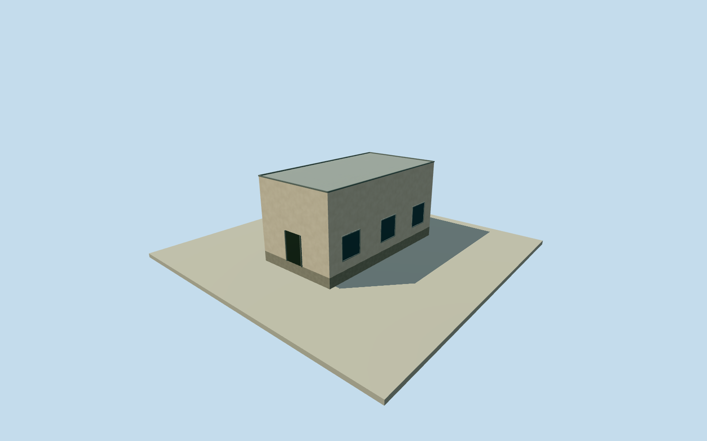

# Tate's Cairn southwest service building

Whole original official fourcorner station service building/full roof/all walls/base/closed entry. Official relative envelope height retained; exact flat roof/facade/finish/internal function estimated. All images unused; radar main building separate.

Authoring state: **review-in-qa.json**. Current completion evidence is in [qa.json](qa.json) and the [completion ledger](../../../../qualla-structures/batches/qualla-002.PROGRESS.md).

- [Tate's Cairn](https://qualla.com/tate-s-cairn/)

Whole original fourcorner building envelope 4046724307T20050430 within Tate's Cairn Meteorological Station, independent of the main radar body. Exact original official numeric footprint and base/top difference; roof profile, facade, finish and internal function unverified. Service label is geographical/descriptive. All images, plans, figures and image-derived descriptions unused. No radome/antenna or whole-station proxy.

All original fourcorner body/walls/roof/base retained. Official BaseHeight574.1m/TopHeight579.3m give generalized envelope height5.2m; they do not establish a detailed roof section or facade. Flat roof and closed service doorway/window/finish are explicit estimates with1.5m component and.8m roof-section uncertainty. No verified internal use/storey count.

Independent256m129x129field/16641heights/1originaltiles/datum554.0621m fixed before floor.25m/foundation-.6..+.25m/roof5.45m. Official absolute base exceeds composite DEM datum by20.038m; vertical datums/ground contact unsurveyed and no artificial plinth/terrain fit applied. Official relative body height retained. No field/frame/floor/mainsection cut/mask/flatten/refetch/reframe/refit.

Qualla first15families/1conflict; conflicting hero and unrelated CC0cross excluded. Every image, photograph, figure, diagram, plan, embedded3Dtexture and image-derived description unused. Official original numerical building geometry/attributes with LandsDepartment attribution only.

Whole independent station service building; descriptive geographic title, exact internal function unverified. Main weather-radar building/radome and other separate structures remain independent. No main radar or whole-station completion credit.

Build: `node content/worldgen/source/places/we/wec/tates_cairn_southwest_service_building/models/generate-house.mjs`. Add `--check` to verify exact regeneration. 448 triangles; 4 materials; no embedded photographs.
