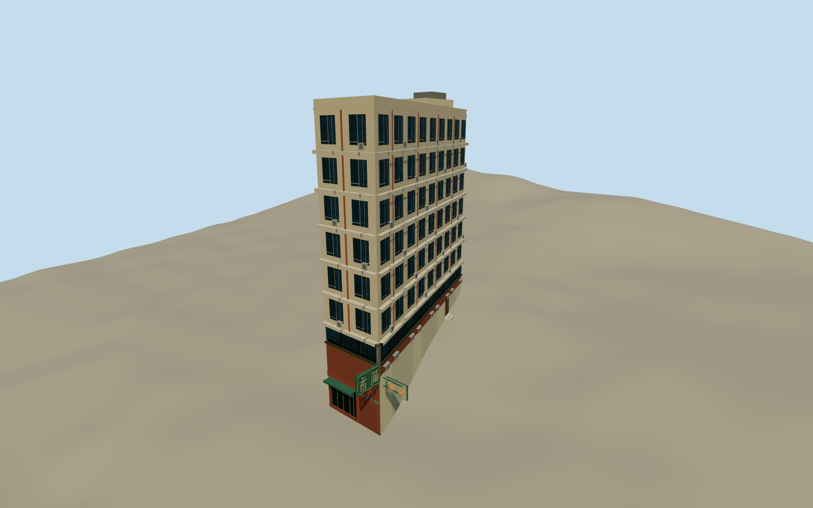

# Tsang Chiu Ho Building

The nine-storey Tsang Chiu Ho Building with its late Lin Heung Tea House shopfront and projecting green signs on the Wellington and Aberdeen Street corner.

Authoring state: **review-in-qa.json**. Current completion evidence is in [qa.json](qa.json) and the [completion ledger](../../../../qualla-structures/batches/qualla-003.PROGRESS.md).

- [Lin Heung Tea House](https://qualla.com/lin-heung-tea-house/)

The model depicts the Wellington Street premises in May 2024, after reopening and before the May 2026 relocation to Sheung Wan.

Ground-floor thresholds and exact upper floor and parapet heights are approximated. The side wall uses a simplified color treatment, and the rear and roof equipment are generalised.

The café interior and adjoining buildings are outside the model scope. The Hong Kong DTM is an independent 5 m grid and supplies approximate sidewalk grades.

Build: `node content/worldgen/source/places/we/wec/tsang_chiu_ho_building/models/generate-tsang-chiu-ho-building.mjs`. Add `--check` to verify exact regeneration. 5199 triangles; 7 materials; no embedded photographs.
