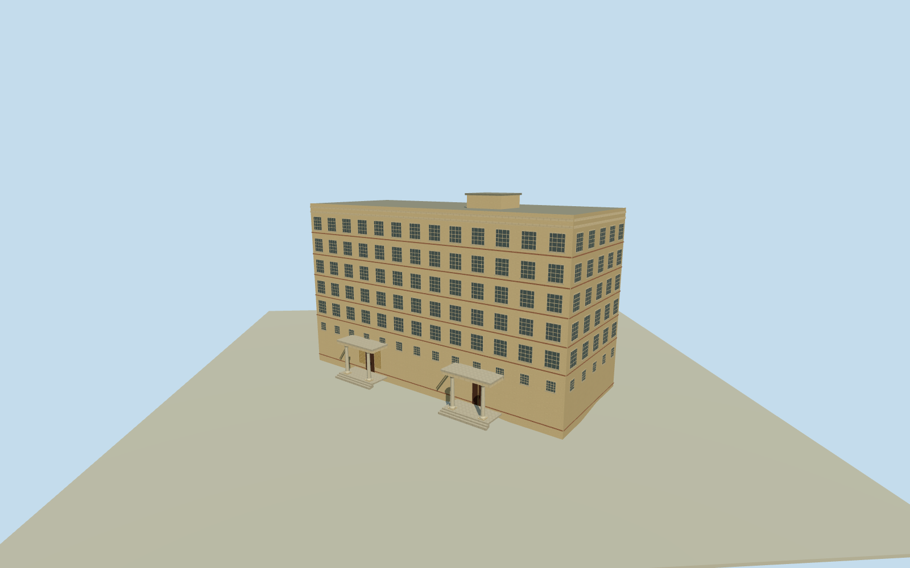

# Tung Wah Hospital

The historic Main Block of Tung Wah Hospital in Sheung Wan with a six-storey cream facade, two entrance porches and small-pane windows.

Authoring state: **review-in-qa.json**. Current completion evidence is in [qa.json](qa.json) and the [completion ledger](../../../../qualla-structures/batches/qualla-003.PROGRESS.md).

- [Tung Wah Hospital](https://qualla.com/tung-wah-hospital/)

This May 2025 exterior represents the 1934 Main Block, including the assembly-hall entrance. Modern hospital towers and indoor galleries are outside the scope.

The protected entrance columns, dark doors and steps follow the exact cleared photograph. Upper façade bay counts, roof fixtures, porch positions and the opposite elevations are approximate.

The hillside elevation grid varies sharply around the block and nearby towers. Original relief remains unchanged; paving levels and ground contact are estimates.

Build: `node content/worldgen/source/places/we/wec/tung_wah_hospital/models/generate-tung-wah-hospital.mjs`. Add `--check` to verify exact regeneration. 4711 triangles; 4 materials; no embedded photographs.
