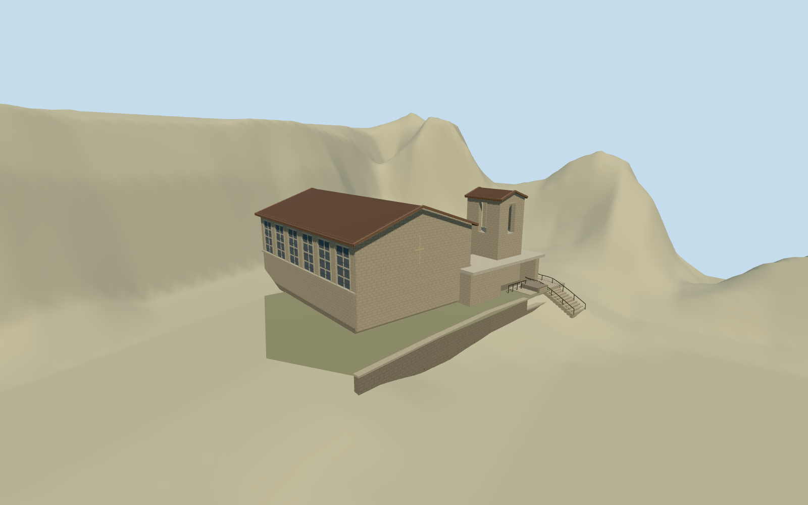

# Union Church, Hong Kong

The 1955 granite Union Church sanctuary, detached bell tower and Kennedy Road entrance as photographed in 2007.

Authoring state: **review-in-qa.json**. Current completion evidence is in [qa.json](qa.json) and the [completion ledger](../../../../qualla-structures/batches/qualla-004.PROGRESS.md).

- [Union Church, Hong Kong](https://qualla.com/union-church-hong-kong/)

The old lot is recorded by the native 2017 map. The exact sanctuary, tower dimensions, step details and rear elevations are estimated from the original 2007 photography and the official building description.

The modeled church is the demolished sanctuary. The 2023 replacement remains separate from the dated model.

Build: `node content/worldgen/source/places/we/wec/union_church_hong_kong/models/generate-union-church-hong-kong.mjs`. Add `--check` to verify exact regeneration. 3437 triangles; 7 materials; no embedded photographs.
