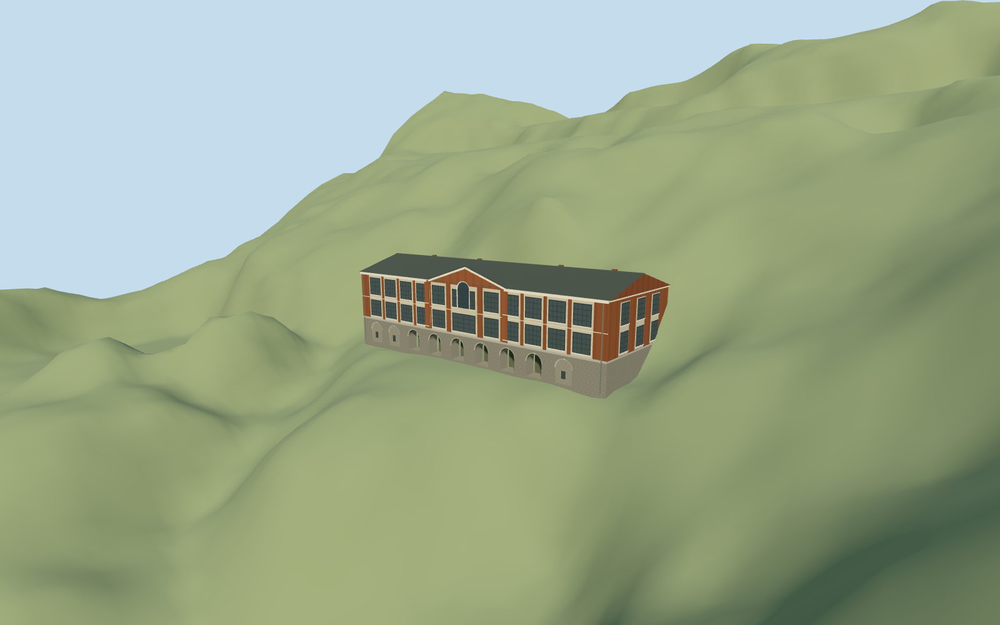

# Victoria Hospital Maternity Block

The surviving 1921 Victoria Hospital Maternity Block, with grey lower arcade, red brick framing, tall windows and a pronounced central pediment.

Authoring state: **review-in-qa.json**. Current completion evidence is in [qa.json](qa.json) and the [completion ledger](../../../../qualla-structures/batches/qualla-003.PROGRESS.md).

- [Victoria Hospital, Hong Kong](https://qualla.com/victoria-hospital-hong-kong/)

The standing 1921 maternity block is the subject. The demolished 1897 hospital main block, the later Victoria House and neighbouring buildings are separate structures.

Wall and ridge heights, window count around the edges, rear detailing and the number of open and blind bays are estimates from the width of the mapped footprint, available photograph and appraisal.

The hillside relief uses the Lands Department original 5 m raster. The historic threshold and contact below the façades are approximate because the raster cannot resolve each step and retaining edge.

Build: `node content/worldgen/source/places/we/wec/victoria_hospital_hong_kong/models/generate-victoria-hospital-hong-kong.mjs`. Add `--check` to verify exact regeneration. 3188 triangles; 6 materials; no embedded photographs.
