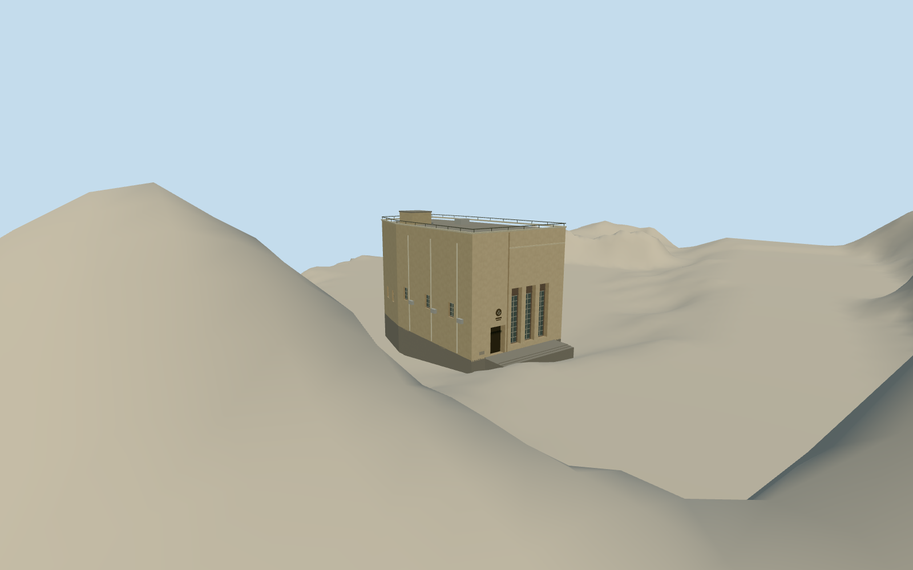

# Zetland Hall

Buff stucco hall with three deeply recessed gridded lights and the main entrance on Kennedy Road.

Authoring state: **review-in-qa.json**. Current completion evidence is in [qa.json](qa.json) and the [completion ledger](../../../../qualla-structures/batches/qualla-003.PROGRESS.md).

- [Zetland Hall](https://qualla.com/zetland-hall/)

The wall photo and two detail photographs control the Kennedy Road facade. Height, roof equipment, rear openings and side volume proportions are estimated.

The adjoining high-rise has a separate footprint. The model covers the hall and its attached service volumes.

The independent Hong Kong Lands Department 5 m ground elevations are preserved as an unmodified site crop. The entrance and foundation use approximate grades from those values.

The exact three Qualla reference photographs remain in the image corpus with their hashes in the model records.

Build: `node content/worldgen/source/places/we/wec/zetland_hall/models/generate-zetland-hall.mjs`. Add `--check` to verify exact regeneration. 1904 triangles; 5 materials; no embedded photographs.
