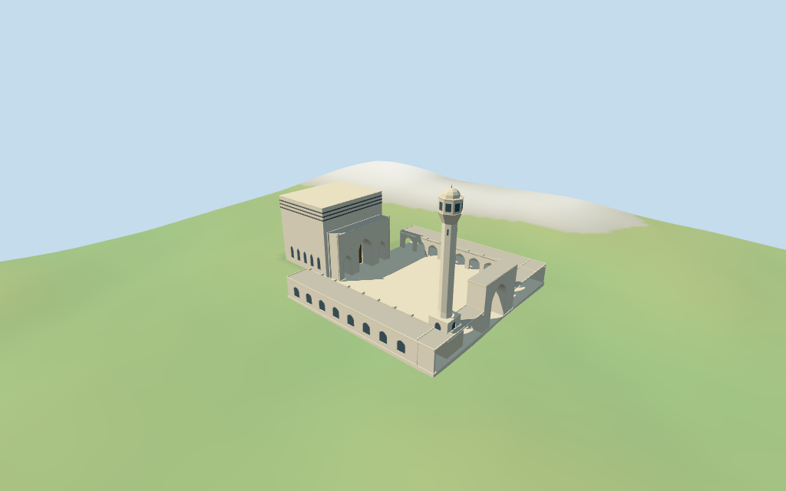

# Baitul Mukarram National Mosque

Individual medium-fi Baitul Mukarram National Mosque: cubic western prayer hall with three dark bands and triple-pointed-arch entrance, open paved east court, low pointed galleries, tall east through gate and southeastern octagonal minaret with flared lantern and small pale cap. Raw compound retained; internal partitions and all heights are picture estimates. Six existing shared 256² graphs and seven merged roles; four budgeted browser LODs. Fine art, furnished interiors and surrounding city omitted.

## Evidence and reconstruction

Published dimensions and reconstructed details are separated in spec.json. Primary references:

- [Reference](https://commons.wikimedia.org/wiki/File:Baitul_mukarram_front.jpg)
- [Reference](https://commons.wikimedia.org/wiki/File:Baitul_Mukarram_(5).jpg)

Six existing shared 256² stucco, continuous limestone, membrane, painted metal, wood and cast-bronze graphs serve seven merged roles, including opaque panes. Metric UVs, linear palette tints, zero embedded images. No unique facade atlas, copied calligraphy or baked night lighting.

## Model and axes

9,676 triangles; 29,028 vertices; 7 material groups; 1,165,344 bytes. Native bounds: -53.784, -3.360, -42.042 to 53.638, 56.175, 41.880. Source hash: `sha256:0f8cab5833ef32df64bb4ddc740c4475324bab3043c2f35af5a8f4cd29414dd3`.

{"x":"east gate","y":"up","z":"south minaret side"}

Normal viewer DEM datum 15.382844477257734 m; working floor -1.2254615064178107 m is the median of 132 outside-perimeter samples at 1 m offset plus 0.3 m. 820 raw footprint samples span -3.7082444772577343..0.6391555227422643 m. Adaptive outline footings seat the compound; preview terrain seats the paving and a 1.5 m margin. Ground cutout follows the full raw outline, covered by model paving. Exact elevated-deck construction, stairs, thresholds, shop levels, paving grades and terrain joins remain unverified.

## Reproduce

Run `node packages/worldgen/scripts/generate-additional-landmarks.mjs --ids=baitul_mukarram_national_mosque` (or add `--check`). The generator preserves manually edited masters by checking their baseline hashes. Import through the standard authored-model workflow with optimization disabled; then capture all QA cameras, including shared-surface views.

## Pending work

- Retained exact way 186664126 / Q804009 is current viewer building 35184558752958. Its eight-vertex T-shaped outline, original anchor [90.412617,23.7294861] and heading zero remain fixed. Positive X east points from the western cubic prayer hall toward the open forecourt and east gate; positive Z is south. Pictures guide that signed layout. Current PMTiles have no height tags, courtyard holes or independent roof/minaret parts. The court, cubic hall partitions, gate and southeastern tower position are explicit picture-led approximations within the mapped compound. Adjacent shops, streets and city buildings remain host content.
- No retained or current map heights exist. Visualization estimates: cubic hall roof/parapet 33.5 m; three dark bands at 27.6, 29.3 and 31 m; projecting triple-arch screen 22 m. Low courtyard galleries about 9 m, east gate 19.5 m. Minaret has an octagonal shaft, flared crown around 49 m, lantern to 53.2 m, pale cap to 56.2 m and finial top 57.4 m. Facade bays, gate widths, minor parapets and all vertical dimensions are estimates, not survey data. Fine calligraphy, lattice art, fixtures and unseen interiors are omitted.
- Normal viewer DEM datum 15.382844477257734 m; working floor -1.2254615064178107 m is the median of 132 outside-perimeter samples at 1 m offset plus 0.3 m. 820 raw footprint samples span -3.7082444772577343..0.6391555227422643 m. Adaptive outline footings seat the compound; preview terrain seats the paving and a 1.5 m margin. Ground cutout follows the full raw outline, covered by model paving. Exact elevated-deck construction, stairs, thresholds, shop levels, paving grades and terrain joins remain unverified.
- Individual approximate compound exterior. Internal court/hall/gate/tower plans and all heights are picture estimates. Closed door/pane fields stop before unmodeled interiors. Minor parapet patterns, lattice/art, precise stairs, elevated deck/shop construction, furnishings, current finish, engineering and physical-device timings remain unverified. Nearby streets, shops and city stay host content.

This bundle follows the medium-fi standard. Medium-fi appearance and geographic fit are reviewed separately. Hash-bound visual acceptance is recorded separately after capture inspection.

## Additional geographic data

©OpenStreetMap contributors; Protomaps; Mapzen/USGS terrain tiles.
